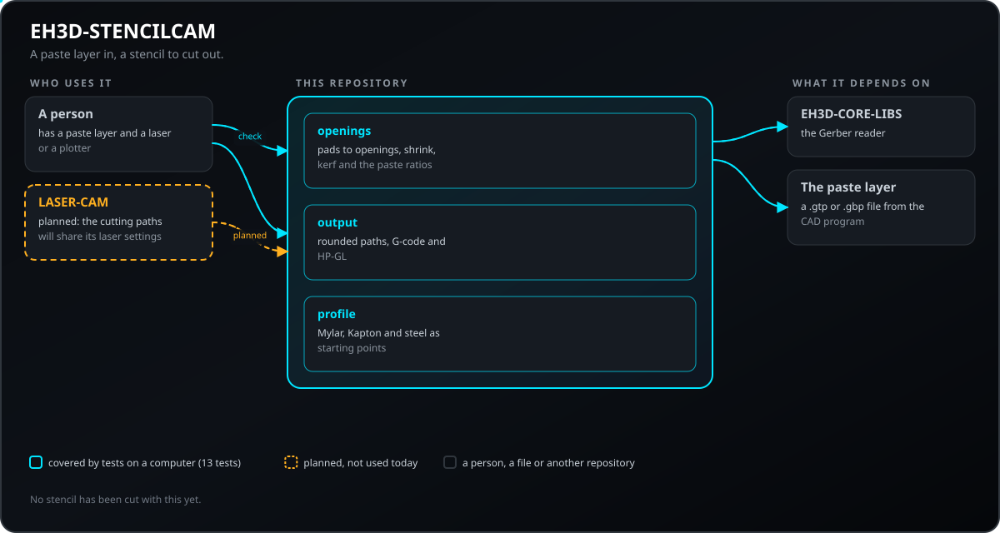
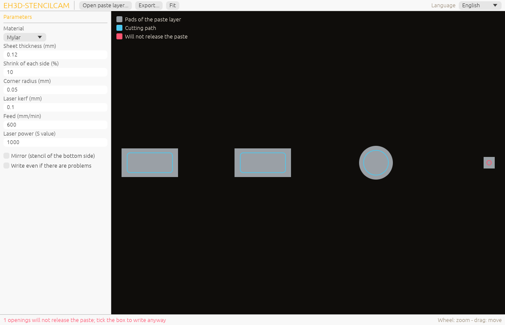
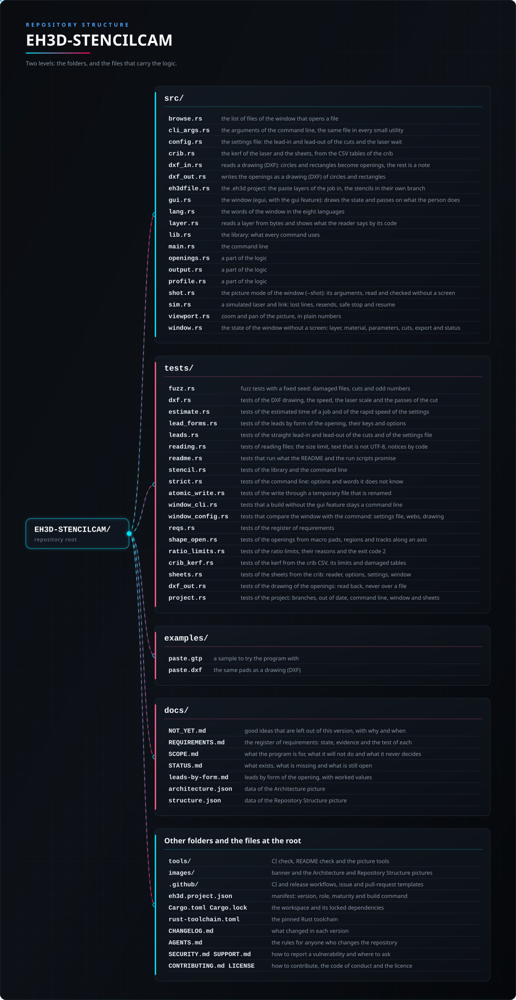

<p align="center">
  
</p>

#  EH3D-STENCILCAM
<p align="center"><a href="README.md">🇺🇸 English</a> | <a href="README_spa.md">🇪🇸 Español</a> | <a href="README_fra.md">🇫🇷 Français</a> | <a href="README_ita.md">🇮🇹 Italiano</a> | 🇩🇪 <b>Deutsch</b> | <a href="README_zho.md">🇨🇳 中文</a> | <a href="README_jpn.md">🇯🇵 日本語</a> | <a href="README_por.md">🇵🇹 Português</a></p>

### Lotpasten-Schablonen aus der Pastenlage: Öffnungen, Verhältnisprüfung und Schneidpfade

<p align="center">
  
  
  
  
  
</p>

---

**Ehrlichkeitscheck - was heute wirklich läuft:** eine Rust-Bibliothek und ein Kommandozeilenprogramm (`eh3d-stencilcam`) mit 321 Tests, die auf einem Computer laufen: wandelt die Pads einer Pastenlage in Schablonenöffnungen um (verkleinert, gerundet, um die Laserschnittbreite kompensiert und auf Pastenablösung geprüft) und schreibt sie als G-Code oder HP-GL. Es hat ein Fenster (Build mit `--features gui`), das eine Pastenebene öffnet und die Pads und die Schneidbahnen zeichnet, das aber noch auf keinem Bildschirm angesehen wurde; es wurde an keiner Maschine ausprobiert und nicht an einer Sammlung echter Dateien geprüft.

---

> **Sicherheitsstatus:** Dieses Programm steuert keine Maschine und ist kein Sicherheitssystem. Was es erzeugt, muss ein Mensch prüfen, bevor etwas an einer Maschine läuft; nichts davon lief auf echter Hardware.


## 📋 Auf einen Blick

| | |
|---|---|
| Version | `0.1.2` |
| Reifegrad | Funktionsfähig |
| Tests | 321 |
| Technologie-Stack | Rust |
| Auf echter Hardware | Nicht erprobt: nichts davon lief an einer Maschine |

**Springe zu:** [Überblick](#-überblick) · [Architektur](#-architektur) · [Schnellstart](#-schnellstart) · [Tests](#-tests) · [Struktur](#-struktur-des-repositorys) · [Verwandte](#-verwandte-projekte)

## 🚦 Projektstatus

Jede Zeile ist ein Teil dieses Repositorys, und die Ampel sagt, wie weit er heute ist. Sie beruht auf dem, was das Repository zeigen kann (Tests, Builds, Läufe), nicht auf dem, was geplant ist.

🟢 Fertig und überprüft · 🟡 Funktioniert, mit bekannten Grenzen · 🟠 Teilweise fertig oder noch nicht überprüft · 🔴 Nicht gemacht oder funktioniert nicht

| Bereich | Stand | Was das hier bedeutet |
|---|---|---|
| Kern | 🟡 | wandelt die Pads einer Pastenlage in Schablonenöffnungen um (verkleinert, gerundet, um die Laserschnittbreite kompensiert und auf Pastenablösung geprüft) und schreibt sie als G-Code oder HP-GL; am Computer mit normalen und beschädigten Eingaben getestet, nicht mit einer Sammlung echter Dateien. |
| Kommandozeile | 🟡 | `eh3d-stencilcam` führt dieselben Funktionen wie die Bibliothek aus und gibt das Ergebnis aus; jeder Fehler kommt als Meldung mit einem Exit-Code ungleich null zurück. |
| Tests | 🟡 | 321 Tests bestehen (`cargo test`), mit Normalfällen, Grenzfällen und beschädigten Eingaben sowie einem simulierten Laser mit einer Verbindung, die Zeilen zufällig (mit Startwert) verliert und beschädigt, Wiederholung, sicherem Halt und Fortsetzung. |
| Sicherheit | 🟡 | Reines sicheres Rust (`forbid(unsafe_code)`): nichts gerät bei den übergebenen Dateien in Panik und ein schlechter Wert ist ein Fehler mit Begründung; keine unabhängige Prüfung. |
| Fenster | 🟠 | Geschrieben (egui, `--features gui`): Pastenebene öffnen oder hineinziehen, Material wählen, Parameter ändern, die Pads und die Schneidbahnen sehen (die Öffnungen, bei denen die Paste hängen bleibt, in Rot), Zoom und Verschieben, exportieren; die Logik ist getestet, aber noch nicht gebaut oder auf einem Bildschirm angesehen. |
| Echte Hardware | 🔴 | Nicht erprobt: nichts davon wurde an einer Maschine ausgeführt. |
| Dokumentation | 🟡 | README in acht Sprachen, das Changelog und die zwei aus `docs/` gezeichneten Bilder. |

## 🎯 Überblick

* **Die Öffnungen** (`src/openings.rs`): Jedes in der Pastenlage geflashte Pad (rechteckig, rund oder oval, in Millimetern, egal in welchen Einheiten die Datei steht) ist eine Öffnung; sie wird um den Prozentsatz des Materials verkleinert, und die Schnittlinie wird um die Schnittbreite des Lasers kleiner, damit das Loch die gewünschte Größe hat. Eine Schablone für die Unterseite kann gespiegelt werden.
* **Die Verhältnisse** (`src/openings.rs`): Das Seitenverhältnis (die kleine Seite durch die Blechdicke, mindestens 1,5) und das Flächenverhältnis (Öffnungsfläche durch Wandfläche, mindestens 0,66) sagen, ob die Paste die Öffnung verlässt; eine durchfallende Öffnung wird mit ihrer Position gemeldet, und `convert` schreibt nichts, bis man sie angesehen hat (oder `--force`).
* **Die Pfade** (`src/output.rs`, `src/profile.rs`): abgerundete Rechtecke, Kreise und Ovale als geschlossene Pfade in der Reihenfolge eines Nächster-zuerst-Wegs; G-Code für einen Laser mit konstanter Leistung, beim Verfahren aus, oder HP-GL mit 40 Einheiten je Millimeter; Profile für Mylar, Kapton und Stahl mit Dicke, Verkleinerung, Eckenradius und Schnittbreite als Startwerten.
* **Eine unvollständige Schablone wird nicht geschrieben:** `convert` verweigert das Schreiben, wenn die Ebene Pads, Leiterbahnen oder Regionen enthält, die keine Öffnungen werden können (ein Polygon, eine Region, die kein Rechteck ist, eine Bahn im Winkel), außer mit `--force`.
* **Die Ebene wird aus ihren Bytes gelesen:** `--max-bytes N` verweigert eine Datei über dem Limit (standardmäßig 256 MiB); Text, der nicht UTF-8 ist, wird mit einer Warnung als Latin-1 gelesen. Warnungen und Fehler des Lesers werden mit ihrem stabilen Code ausgegeben, und `--hide CODE[,CODE]` lässt die Meldungen dieser Codes weg; ein Fehler des Lesers zählt als verlorener Teil der Ebene, daher verweigert `convert` ihn außer mit `--force`. Die Öffnungen stammen aus der Umwandlung der Blenden von EH3D-GERBERVIEWER, und ein Polygon-Pad wird als Kreis geschnitten (mit einem Hinweis, daher verweigert `convert` auch das außer mit `--force`). `--arc-tolerance MM` legt fest, wie genau Bögen nachgezeichnet werden, und die Ablehnung einer zu großen Datei erscheint in der Sprache des Systems.

## 🧩 Rolle in EH3D

EH3D-STENCILCAM ist ein Programm der EH3D Fabrication Suite. Es arbeitet als Bibliothek und Kommandozeile und, mit `--features gui` gebaut, als Fenster im gemeinsamen Aussehen der Suite. Es liest und schreibt einfache Dateien und lässt sich allein oder zwischen den anderen Programmen nutzen.

## 🏛️ Architektur

<p align="center">
  
</p>


Wie die Teile dieses Repositorys zusammenpassen: wer es nutzt, was es enthält und wovon es abhängt. Das Bild wird aus `docs/architecture.json` gezeichnet und gegen den Code geprüft.

## 🖼️ Screenshots

<p align="center">
  
</p>

<p align="center"><em>Das Fenster mit der Beispiel-Pastenlage: die Pads, der Schneidpfad jeder Öffnung und die Öffnung, die die Paste nicht löst, mit ihrem Hinweis unten.</em></p>

## ✨ Funktionen

* **Bibliothek und Kommandozeile:** Jeder Befehl von `eh3d-stencilcam` ist eine Funktion der Bibliothek, sodass ein anderes Programm der Suite ihn ohne Prozessstart aufrufen kann.
* **Strenge Kommandozeile:** Eine falsch geschriebene Option (`--powr`) oder ein überzähliges Wort ist ein Fehler, der sie nennt, und wird nicht ignoriert; sonst würde das Programm seine Ausgabe mit den Standardwerten erzeugen.
* **Tests mit beschädigten Eingaben:** Die Tests füttern auch leere Dateien, Datenmüll, riesige Zahlen und abgeschnittene Dateien; keiner darf in Panik geraten.
* **Kein Raten:** Ein unsinniger Wert ist ein Fehler, der sagt welcher und warum, nie ein Ergebnis, das nur richtig aussieht.
* **Das Programm für den Laser wird nie halb geschrieben:** Die G-Code- oder HP-GL-Datei wird in der Kommandozeile und im Fenster in eine temporäre Datei neben der echten geschrieben und darüber umbenannt, sodass ein Abbruch oder eine volle Platte die alte Datei heil lassen und kein Programm, das mitten im Schnitt endet. Bei einem Fehler wird die temporäre Datei entfernt und der Fehler beginnt mit dem Code `file_unwritable` und dem Dateinamen.
* **Kein unsafe-Code:** `#![forbid(unsafe_code)]` in Bibliothek und Programm.
* **Der G-Code trägt den Standardkopf und eine schnellere Reihenfolge:** die Datei beginnt mit Kommentarzeilen für den Erzeuger, die Einheiten und die Ebene mit ihrem SHA-256, ein Rechteck mit scharfen Ecken hat keine wiederholten Punkte, und die Reihenfolge der Schnitte wird mit einem Raster gefunden, sodass hunderttausend Öffnungen in Augenblicken geordnet sind.
* **Eine Wartezeit nach dem Einschalten des Lasers:** `--laser-wait SEKUNDEN` schreibt nach jedem `M3` eine `G4`-Wartezeit, damit der Laser seine Leistung hat, bevor sich der Kopf bewegt (standardmäßig 0: keine Wartezeit); die Tests lesen den G-Code mit dem Leser der Suite wieder ein und finden keine Warnung und keinen Schnitt bei ausgeschaltetem Laser. `--rapid MM_MIN` (oder `rapid_mm_min` in `stencil.cfg`, von 100 bis 100000, standardmäßig 0: keine Schätzung) ist die Geschwindigkeit der Bewegungen bei ausgeschaltetem Laser: `convert` gibt dann die geschätzte Dauer des G-Code-Auftrags aus (Schneiden, Warten auf den Laser und Verfahren; die Beschleunigung der Maschine wird nicht gezählt).
* **Die Schablone auf dem Blech platzieren:** `--origin X,Y` setzt die linke untere Ecke der Öffnungen auf X,Y und `--bed BREITE,HÖHE` verweigert das Schreiben, wenn ein Punkt einer Kontur außerhalb des Tisches liegt (die Anfahrten zählen nicht); ohne sie gelten die Koordinaten der Platine unverändert.
* **Ein gerader Ein- und Auslauf bei jedem Schnitt:** der G-Code kann jede Kontur auf einer Geraden tangential zu ihrem ersten Segment betreten und auf der Verlängerung des letzten verlassen (standardmäßig je 0,3 mm, `--lead-in MM`, `--lead-out MM` oder `lead_in_mm` und `lead_out_mm` in `stencil.cfg`; 0 schreibt keinen, und das Programm ist das ohne Ein- und Auslauf geschriebene). Der Laser bleibt aus, während der Kopf zum Anfang des Einlaufs fährt, wird dort eingeschaltet (und wartet, wenn verlangt) und am Ende des Auslaufs ausgeschaltet. Die Konturen sind konvex und laufen gegen den Uhrzeigersinn, daher liegen beide Strecken außerhalb der Öffnung auf dem Blech, das bleibt; in HP-GL wird keiner geschrieben.
* **Ein- und Auslauf je nach Form:** Eine runde und eine rechteckige Öffnung können ihren eigenen Ein- und Auslauf haben (`--lead-in-round MM`, `--lead-out-round MM`, `--lead-in-rect MM`, `--lead-out-rect MM` oder `lead_in_round_mm`, `lead_out_round_mm`, `lead_in_rect_mm`, `lead_out_rect_mm` in `stencil.cfg`, von 0 bis 5 mm); ein nicht angegebener ist der allgemeine `--lead-in` bzw. `--lead-out`, und eine Langlochöffnung (Obround) verwendet immer die allgemeinen. Die Zeitschätzung zählt die Längen jeder Form. Siehe `docs/leads-by-form.md`.
* **Eine Zeichnung als Eingabe sowie Geschwindigkeit, Laserskala und Durchgänge in `stencil.cfg`:** Eine Datei mit der Endung `.dxf` wird als Zeichnung gelesen (Kreise werden zu runden Öffnungen, geschlossene Rechtecke mit Seiten entlang der Achsen zu rechteckigen; die Einheit der Zeichnung wird gelesen, und jedes andere Element ist ein Hinweis, sodass `convert` nur mit `--force` schreibt); `--feed`, `--smax` und `--passes` (`feed_mm_min`, `smax` und `passes` in der Datei; Standard 600 mm/min, 1000 und ein Durchgang) legen die Schnittgeschwindigkeit, das Ende der Laserleistungsskala und die Zahl der Durchgänge über jede Kontur fest. Nur am Rechner getestet: auf einem Laser wurde nichts geschnitten.
* **Schmale Stege, doppelte Öffnungen und die Paste in `check`:** `--min-web MM` (oder `min_web_mm` in `stencil.cfg`, von 0 bis 5 mm, standardmäßig 0,1, 0 für keine Warnung) warnt in `check` und in `convert` vor zwei Öffnungen, deren Steg (die Folie, die zwischen ihnen bleibt) schmaler ist oder die sich berühren oder überlappen, und hält `convert` nie an; zwei Öffnungen gleicher Form, Größe und Lage sind ein einziges Loch, die zweite wird deshalb mit einem Hinweis weggelassen, statt zweimal geschnitten zu werden; `check` gibt aus, wie viele Öffnungen es je Form gibt und wie viel Paste sie fassen (in Mikrolitern), und `check --json` gibt dies und den Rest des Ergebnisses als ein einziges JSON-Objekt für andere Programme aus. Nur auf einem Computer getestet.
* **Die Folie aus dem Werkzeuglager:** `--sheet-file FOLIEN.csv --sheet NAME` (oder `sheet_file` und `sheet_name` in `stencil.cfg`) nimmt eine Folie aus der Folientabelle, die das Werkzeuglager exportiert (`export-sheets-csv`): ihre Dicke, ihre Verkleinerung jeder Öffnung je Seite, ihre Schnittfuge (eine Schnittfuge von 0 nimmt die Strahlbreite des Lasers von `--crib`) und ihre Verhältnisgrenzen ersetzen die des Materials. Die Spalten werden an ihren Namen gefunden, die Datei wird mit einer Größen- (1 MiB) und einer Zeilengrenze gelesen, jeder Fehler nennt seine Zeile, und die Kommandozeile geht vor der Folie, die Folie vor der Einstellungsdatei. Keine Zahl ist ein Standardwert dieses Programms: eine Grenze von 0 gibt keine. Das Fenster zeigt die gewählte Folie.
* **Eine Zeichnung als Ausgabe:** `convert EBENE AUS.dxf` schreibt die Öffnungen, wie die Schablone sie hat, Kreise und Rechtecke in Millimetern, sodass dasselbe Programm sie wieder einliest; ein Langloch wird abgelehnt, außer `--force` lässt es weg, und eine vorhandene Datei wird nie ersetzt, außer mit `--overwrite` (`--create`, der Standard, lehnt sie ab).

## 🔒 Sicherheit und Schutz

| Bedrohung | Schutz |
|---|---|
| Eine beschädigte, abgeschnittene oder leere Datei | keine Panik: die Tests schneiden gültige Eingaben an jeder Stelle ab und füttern Datenmüll |
| Eine unsinnige Zahl (negativ, nicht endlich, absurd groß) | wird mit einem Fehler abgelehnt, der den Wert nennt; nichts wird zu etwas Plausiblem gerundet |
| Unsichere Speichernutzung | reines sicheres Rust mit `forbid(unsafe_code)` |

**Was nicht abgesichert ist:** Ein fehlerfrei erzeugtes Ergebnis ist kein geprüftes Ergebnis. Nichts hier kennt die Grenzen einer Maschine, und das Programm hatte keine unabhängige Prüfung. Eine Schwachstelle bitte privat melden (siehe [SECURITY.md](SECURITY.md)).

## 🔌 Schnittstellen

Die Bibliothek ist `eh3d_stencilcam` (`use eh3d_stencilcam::...`); die Kommandozeile ist `eh3d-stencilcam`. Die Befehle sind diese; jeder gibt sein Ergebnis auf der Standardausgabe aus und meldet einen Fehler auf der Fehlerausgabe mit einem Exit-Code ungleich null. Es gibt keinen Netzwerkzugriff.

```text
EH3D-STENCILCAM/
├── src/
│   ├── browse.rs                                die Dateiliste des Fensters zum Öffnen einer Datei
│   ├── cli_args.rs                              die Argumente der Kommandozeile, dieselbe Datei in jedem kleinen Werkzeug
│   ├── config.rs                                die Einstellungsdatei: Ein- und Auslauf der Schnitte und die Laser-Wartezeit
│   ├── crib.rs                                  die Schnittfuge des Lasers und die Folien aus den CSV-Tabellen
│   ├── dxf_in.rs                                liest eine Zeichnung (DXF): Kreise und Rechtecke werden zu Öffnungen, der Rest ist ein Hinweis
│   ├── dxf_out.rs                               schreibt die Öffnungen als Zeichnung (DXF) aus Kreisen und Rechtecken
│   ├── eh3dfile.rs                              das .eh3d-Projekt: Pastenebenen des Auftrags hinein, Schablonen in den eigenen Zweig
│   ├── gui.rs                                   das Fenster (egui, mit dem Feature gui): zeichnet den Zustand und gibt weiter, was die Person tut
│   ├── lang.rs                                  die Wörter des Fensters in den acht Sprachen
│   ├── layer.rs                                 liest eine Ebene aus Bytes und zeigt die Meldungen des Lesers nach ihrem Code
│   ├── lib.rs                                   die Bibliothek: was jeder Befehl nutzt
│   ├── main.rs                                  die Kommandozeile
│   ├── openings.rs                              ein Teil der Logik
│   ├── output.rs                                ein Teil der Logik
│   ├── profile.rs                               ein Teil der Logik
│   ├── shot.rs                                  der Bildmodus des Fensters (--shot): seine Argumente, ohne Bildschirm gelesen und geprüft
│   ├── sim.rs                                   ein simulierter Laser samt Verbindung: Zeilenverlust, Wiederholung, sicherer Halt, Fortsetzung
│   ├── viewport.rs                              Zoom und Verschiebung des Bildes, in einfachen Zahlen
│   └── window.rs                                der Zustand des Fensters ohne Bildschirm: Ebene, Material, Parameter, Schnitte, Export und Status
├── tests/
│   ├── fuzz.rs                                  Tests mit festem Startwert: beschädigte Dateien, Abschnitte und seltsame Zahlen
│   ├── dxf.rs                                   Tests der DXF-Zeichnung, der Geschwindigkeit, der Laserskala und der Durchgänge des Schnitts
│   ├── estimate.rs                              Tests der geschätzten Dauer eines Auftrags und der Eilgangsgeschwindigkeit der Einstellungen
│   ├── lead_forms.rs                            Tests von Ein- und Auslauf je nach Form der Öffnung und ihrer Einstellungen
│   ├── leads.rs                                 Tests des geraden Ein- und Auslaufs der Schnitte und der Einstellungsdatei
│   ├── reading.rs                               Tests zum Lesen von Dateien: Größenlimit, Text ohne UTF-8, Meldungen nach Code
│   ├── readme.rs                                Tests, die ausführen, was README und run-Skripte versprechen
│   ├── stencil.rs                               Tests von Bibliothek und Kommandozeile
│   ├── strict.rs                                Tests der Kommandozeile: Optionen und Wörter, die sie nicht kennt
│   ├── atomic_write.rs                          Tests des Schreibens über eine temporäre Datei, die umbenannt wird
│   ├── window_cli.rs                            Tests, dass ein Build ohne das Feature gui eine reine Kommandozeile bleibt
│   ├── reqs.rs                                  Tests des Anforderungsregisters
│   ├── shape_open.rs                            Tests der Öffnungen aus Makro-Pads, Regionen und Bahnen entlang einer Achse
│   ├── ratio_limits.rs                          Tests der Verhältnisgrenzen, ihrer Begründungen und des Exit-Codes 2
│   ├── crib_kerf.rs                             Tests der Schnittfuge aus dem Werkzeug-CSV, seiner Grenzen und beschädigter Tabellen
│   ├── sheets.rs                                Tests der Folien aus der Werkzeugverwaltung: Leser, Optionen, Einstellungen, Fenster
│   ├── dxf_out.rs                               Tests der Zeichnung der Öffnungen: Rücklesen, nie über eine Datei
│   └── project.rs                               Tests des Projekts: Zweige, Veraltetes, Befehlszeile, Fenster und Folien
├── examples/
│   ├── paste.gtp                                ein Beispiel zum Ausprobieren
│   └── paste.dxf                                dieselben Pads als Zeichnung (DXF)
├── docs/
│   ├── NOT_YET.md                               gute Ideen außerhalb dieser Version, mit Grund und Zeitpunkt
│   ├── REQUIREMENTS.md                          das Register der Anforderungen: Stand, Nachweis und Test jeder einzelnen
│   ├── SCOPE.md                                 wofür es da ist, was es nicht tut und was es nie entscheidet
│   ├── STATUS.md                                was es gibt, was fehlt und was offen ist
│   ├── leads-by-form.md                         Ein- und Auslauf je nach Form, mit berechneten Werten
│   ├── architecture.json                        Daten des Architektur-Bildes
│   └── structure.json                           Daten des Struktur-Bildes
├── tools/                                       CI-Prüfung, README-Prüfung und die Bildwerkzeuge
├── images/                                      Banner und die Bilder von Architektur und Repository-Struktur
├── .github/                                     CI- und Release-Workflows, Vorlagen für Issues und Pull Requests
├── eh3d.project.json                            Manifest: Version, Rolle, Reifegrad und Build-Befehl
├── Cargo.toml Cargo.lock                        der Workspace und seine festgelegten Abhängigkeiten
├── rust-toolchain.toml                          die festgelegte Rust-Toolchain
├── CHANGELOG.md                                 was sich in jeder Version geändert hat
├── AGENTS.md                                    die Regeln für alle, die das Repository ändern
├── SECURITY.md SUPPORT.md                       Schwachstellen melden und Fragen stellen
└── CONTRIBUTING.md CODE_OF_CONDUCT.md LICENSE   Mitwirken, Verhaltenskodex und Lizenz
```

**Das Projekt der Suite.** Eine `.eh3d`-Datei hat einen Zweig je Programm. `project info DATEI.eh3d` zeigt die Ebenen des Auftrags (Zweig `manufacturing/`, ein `.eh3dproj`-Paket) und die im Projekt gespeicherten Schablonen; `project convert DATEI.eh3d [--layer NAME] [--plt]` macht aus jeder Pastenebene des Auftrags (oder der genannten) eine Schablone, mit denselben Optionen und Ablehnungen wie `convert`, und speichert sie nur im Zweig `stencilcam/`, mit einer Kopie der Ebene und dem Inhalt des Zweigs, aus dem sie stammt. Ändert sich der Auftrag danach, meldet `project info`, dass die Schablonen veraltet sind, und endet mit 2. Im Fenster öffnet eine hineingezogene `.eh3d`-Datei die Pastenebenen ihres Auftrags (Ober- und Unterseite werden aus einer Liste gewählt), die Schablone wird ins Projekt gespeichert, und eine Folientabelle (`.csv`, hineingezogen oder über ihre Schaltfläche geöffnet) bietet ihre Folien in einer Liste an.

## ⚙️ Konfiguration

Eine kleine Einstellungsdatei, `stencil.cfg` (`Schlüssel = Wert`, eine pro Zeile, `#` beginnt einen Kommentar), enthält, was sich einzustellen lohnt: `lead_in_mm` und `lead_out_mm`, die Länge des geraden Einlaufs vor jeder Kontur und des Auslaufs danach (standardmäßig 0,3 mm, von 0 bis 5; 0 schreibt keinen), und `laser_wait_s`, die Wartezeit nach dem Einschalten des Lasers (standardmäßig 0, bis 60). `eh3d-stencilcam config` gibt die Datei mit allen Standardwerten aus (`examples/stencil.cfg` ist diese Datei), und `--config DATEI` liest eine; `--lead-in MM`, `--lead-out MM` und `--laser-wait SEKUNDEN` geben dieselben Einstellungen auf der Kommandozeile an und gehen der Datei vor. Ein unbekannter, doppelter oder außerhalb seines Bereichs liegender Schlüssel ist ein Fehler, der seine Zeile nennt. Der Rest wird als Argumente der Kommandozeile angegeben (siehe Schnittstellen), und jeder Standardwert steht in der Hilfe des Befehls (`eh3d-stencilcam help`). Die festen Grenzen stehen als benannte Konstanten im Code und sind durch Tests abgedeckt. `lead_in_round_mm`, `lead_out_round_mm`, `lead_in_rect_mm`, `lead_out_rect_mm` (mit den Optionen `--lead-in-round`, `--lead-out-round`, `--lead-in-rect` und `--lead-out-rect`) geben Ein- und Auslauf der runden und der rechteckigen Öffnungen an; in der Datei stehen sie als Kommentare, und wenn sie nicht angegeben sind, gelten die allgemeinen `lead_in_mm` und `lead_out_mm`. `min_web_mm` (mit `--min-web`) ist der schmalste Steg zwischen zwei Öffnungen, vor dem nicht gewarnt wird (standardmäßig 0,1 mm, von 0 bis 5; 0 gibt keine Warnung). `min_aspect` und `min_area` (mit `--min-aspect` und `--min-area`) sind die Verhältnisgrenzen, unter denen eine Öffnung die Paste nicht freigibt (standardmäßig 1,5 und 0,66), und `region_fit_percent` (mit `--region-fit`, standardmäßig 0, bis 20) öffnet eine Region, die ihr Rechteck fast ausfüllt, etwa ein Pad mit abgeschnittenen Ecken, als dieses Rechteck. `--crib DATEI.csv --crib-laser NAME` nimmt die Schnittfuge von einem Laserwerkzeug aus dem CSV, das die Werkzeugverwaltung exportiert. Eine Prüfung, die nicht besteht, endet mit dem Code 2.

**Servermodus.** `convert --to-server` legt den soeben geschriebenen G-Code (oder den HP-GL-Plot) als Artefakt auf dem EH3D-Server ab, mit den Werten, mit denen geschnitten wurde, und `check --json --to-server` legt das Ergebnis der Prüfung ab, damit die anderen Programme der Suite sie dort finden. Die Verbindung ist der eine Client der Suite (`eh3d-serverclient` aus EH3D-COMMON); ihre Schlüssel stehen in der Einstellungsdatei: `server_address` (`host:port`; leer bedeutet aus), `server_token` (nur schreibbar, wird nie angezeigt), `server_machine`, `server_timeout_s` (1 bis 120, Standard 15), `server_retries` (0 bis 5, Standard 2), `server_mdns` (Standard `off`) und `server_max_answer_mib` (1 bis 256, Standard 8). Die Ablehnungen des Servers werden anhand ihres Codes in der Sprache des Systems erklärt. `eh3d-stencilcam server status --config FILE` zeigt die Einstellungen (das Token als `***`) und die Antwort des Servers. Ohne Adresse wird nichts gesendet, und die lokale Arbeit hängt nie vom Server ab.

## 🚀 Schnellstart

Sie brauchen eine stabile Rust-Toolchain (1.89 oder neuer).

```bash
cargo build --release
cargo test
cargo run --release -- check examples/paste.gtp
cargo run --release --features gui   # the window
cargo run --release --features gui -- --shot screen.png examples/paste.gtp   # a picture of the window
```

Um ein Bild des Fensters aufzunehmen, ohne es von Hand zu öffnen, starten Sie es mit `--shot DATEI.png` (auch `--size WxH`, `--theme forge|dark|light`, `--wait N`, `--lang CODE`, `--open FILE`, `--replace`): Es öffnet sich in dieser Größe, speichert das PNG, behält keine Einstellungen und schließt sich selbst (Exit-Code 0, wenn die Datei geschrieben wurde, 1, wenn nicht, 2 bei falschen Argumenten).

## 🧪 Tests

Die Suite hat 321 Tests (`cargo test`, in der CI unter Windows und Linux). Sie prüfen Normalfälle, Grenzfälle und beschädigte Eingaben: leere Dateien, Datenmüll und abgeschnittene Dateien lösen nie eine Panik aus. Die CI führt außerdem `cargo fmt --check`, `cargo clippy` mit Warnungen als Fehlern und `python -I tools/ci_validate.py` aus.

## 🏗️ Build und Veröffentlichung

Die Version steht in `Cargo.toml` und in `eh3d.project.json`; jede Version hat ihren Eintrag in [CHANGELOG.md](CHANGELOG.md). `build.bat` / `build.sh` bauen das Programm, `test.bat` / `test.sh` führen die Tests aus und `run.bat` / `run.sh` starten es mit einem Beispiel. Releases erscheinen auf GitHub.

### Downloads

Jede Version enthält das Programm mit seinem Fenster für Windows (64 und 32 Bit), Linux (64 Bit) und macOS (Apple Silicon und Intel) als `<Name>-<Version>-<System>.zip` (Windows) oder `.tar.gz` mit dem Programm, der Lizenz, der Readme, dem Symbol und den Beispielen. Die Dateien werden von GitHub Actions gebaut, stehen in `SHA256SUMS` und sind mit dem EH3D-Schlüssel signiert. Um einen Download zu prüfen, vergleiche seinen Hash mit der danebenliegenden `.sha256`-Datei (`sha256sum -c`) und prüfe die Signatur mit der danebenliegenden `.sig`-Datei (`ssh-keygen -Y verify`).

## 📂 Struktur des Repositorys

<p align="center">
  
</p>

<details>
<summary>Textversion des Baums</summary>

```text
EH3D-STENCILCAM/
├── src/
│   ├── browse.rs                                die Dateiliste des Fensters zum Öffnen einer Datei
│   ├── cli_args.rs                              die Argumente der Kommandozeile, dieselbe Datei in jedem kleinen Werkzeug
│   ├── config.rs                                die Einstellungsdatei: Ein- und Auslauf der Schnitte und die Laser-Wartezeit
│   ├── dxf_in.rs                                liest eine Zeichnung (DXF): Kreise und Rechtecke werden zu Öffnungen, der Rest ist ein Hinweis
│   ├── gui.rs                                   das Fenster (egui, mit dem Feature gui): zeichnet den Zustand und gibt weiter, was die Person tut
│   ├── lang.rs                                  die Wörter des Fensters in den acht Sprachen
│   ├── layer.rs                                 liest eine Ebene aus Bytes und zeigt die Meldungen des Lesers nach ihrem Code
│   ├── lib.rs                                   die Bibliothek: was jeder Befehl nutzt
│   ├── main.rs                                  die Kommandozeile
│   ├── openings.rs                              ein Teil der Logik
│   ├── output.rs                                ein Teil der Logik
│   ├── profile.rs                               ein Teil der Logik
│   ├── shot.rs                                  der Bildmodus des Fensters (--shot): seine Argumente, ohne Bildschirm gelesen und geprüft
│   ├── sim.rs                                   ein simulierter Laser samt Verbindung: Zeilenverlust, Wiederholung, sicherer Halt, Fortsetzung
│   ├── viewport.rs                              Zoom und Verschiebung des Bildes, in einfachen Zahlen
│   └── window.rs                                der Zustand des Fensters ohne Bildschirm: Ebene, Material, Parameter, Schnitte, Export und Status
├── tests/
│   ├── fuzz.rs                                  Tests mit festem Startwert: beschädigte Dateien, Abschnitte und seltsame Zahlen
│   ├── dxf.rs                                   Tests der DXF-Zeichnung, der Geschwindigkeit, der Laserskala und der Durchgänge des Schnitts
│   ├── estimate.rs                              Tests der geschätzten Dauer eines Auftrags und der Eilgangsgeschwindigkeit der Einstellungen
│   ├── lead_forms.rs                            Tests von Ein- und Auslauf je nach Form der Öffnung und ihrer Einstellungen
│   ├── leads.rs                                 Tests des geraden Ein- und Auslaufs der Schnitte und der Einstellungsdatei
│   ├── reading.rs                               Tests zum Lesen von Dateien: Größenlimit, Text ohne UTF-8, Meldungen nach Code
│   ├── readme.rs                                Tests, die ausführen, was README und run-Skripte versprechen
│   ├── stencil.rs                               Tests von Bibliothek und Kommandozeile
│   ├── strict.rs                                Tests der Kommandozeile: Optionen und Wörter, die sie nicht kennt
│   ├── atomic_write.rs                          Tests des Schreibens über eine temporäre Datei, die umbenannt wird
│   ├── window_cli.rs                            Tests, dass ein Build ohne das Feature gui eine reine Kommandozeile bleibt
│   └── reqs.rs                                  Tests des Anforderungsregisters
├── examples/
│   ├── paste.gtp                                ein Beispiel zum Ausprobieren
│   └── paste.dxf                                dieselben Pads als Zeichnung (DXF)
├── docs/
│   ├── NOT_YET.md                               gute Ideen außerhalb dieser Version, mit Grund und Zeitpunkt
│   ├── REQUIREMENTS.md                          das Register der Anforderungen: Stand, Nachweis und Test jeder einzelnen
│   ├── SCOPE.md                                 wofür es da ist, was es nicht tut und was es nie entscheidet
│   ├── STATUS.md                                was es gibt, was fehlt und was offen ist
│   ├── leads-by-form.md                         Ein- und Auslauf je nach Form, mit berechneten Werten
│   ├── architecture.json                        Daten des Architektur-Bildes
│   └── structure.json                           Daten des Struktur-Bildes
├── tools/                                       CI-Prüfung, README-Prüfung und die Bildwerkzeuge
├── images/                                      Banner und die Bilder von Architektur und Repository-Struktur
├── .github/                                     CI- und Release-Workflows, Vorlagen für Issues und Pull Requests
├── eh3d.project.json                            Manifest: Version, Rolle, Reifegrad und Build-Befehl
├── Cargo.toml Cargo.lock                        der Workspace und seine festgelegten Abhängigkeiten
├── rust-toolchain.toml                          die festgelegte Rust-Toolchain
├── CHANGELOG.md                                 was sich in jeder Version geändert hat
├── AGENTS.md                                    die Regeln für alle, die das Repository ändern
├── SECURITY.md SUPPORT.md                       Schwachstellen melden und Fragen stellen
└── CONTRIBUTING.md CODE_OF_CONDUCT.md LICENSE   Mitwirken, Verhaltenskodex und Lizenz
```

</details>

## 🗺️ Roadmap und bekannte Grenzen

**Bekannte Grenzen heute**

* Das Fenster wurde noch auf keinem Bildschirm angesehen und zeigt die Verhältnisse jeder Öffnung nicht an: das tut `check`.
* Es wurde weder an einer Maschine noch mit einer Sammlung echter Dateien erprobt und hatte keine unabhängige Prüfung.
* Ein Polygon-Pad der Pastenlage wird als Kreis geschnitten, und eine Bahn im Winkel oder eine Region, die kein Rechteck ist, wird nicht zur Öffnung (ein Hinweis sagt warum), die Materialprofile sind Startwerte, und ein mehrfaches Schneiden in Durchgängen für ein Stahlblech gibt es nicht.

**Als Nächstes**

* Mit einer echten Pastenlage und einem Laser ausprobieren.
* Das Fenster auf einem Bildschirm ansehen und vervollständigen: ein Bedienelement zur Wahl der Folie aus dem Werkzeuglager und eine Ansicht der Pastenverhältnisse jeder Öffnung.
* Mit echten Dateien und den anderen Programmen der Suite ausprobieren.

## 🌍 Sprachen

README und Texte gibt es auf Englisch, Spanisch, Französisch, Italienisch, Deutsch, Chinesisch, Japanisch und europäischem Portugiesisch.

## 🔗 Verwandte Projekte

* [EH3D-CORE-LIBS](https://github.com/JuanenRac/EH3D-CORE-LIBS): die Leser für Gerber, Excellon und G-Code
* [EH3D-PHOENIX-LASER](https://github.com/JuanenRac/EH3D-PHOENIX-LASER): Lasergravur und Laserschneiden
* [EH3D-GERBERVIEWER](https://github.com/JuanenRac/EH3D-GERBERVIEWER): der Betrachter für Gerber-Lagen
* [EH3D-TOOL-MANAGER](https://github.com/JuanenRac/EH3D-TOOL-MANAGER): das Werkzeuglager der CAM-Programme
* [EH3D-CAM-DEBUGGER](https://github.com/JuanenRac/EH3D-CAM-DEBUGGER): die Prüfung von G-Code, bevor er eine Maschine erreicht

## 📚 Dokumentation

* [Changelog](CHANGELOG.md)
* [Umfang](docs/SCOPE.md): wofür das Programm da ist, was es nicht tut und was es nie entscheidet.
* [Anforderungen](docs/REQUIREMENTS.md): das Register der Fähigkeiten, der Stand jeder einzelnen und der Test, der sie zeigt.
* [Stand](docs/STATUS.md): was es gibt, was fehlt und was noch offen ist.
* [Noch nicht](docs/NOT_YET.md): gute Ideen, die in dieser Version fehlen.
* [Regeln für Änderungen am Repository](AGENTS.md): die Regeln für alle, die das Repository ändern.
* [Architektur- und Strukturdaten](docs/architecture.json): die Daten, aus denen die beiden Bilder gezeichnet werden.

## 🤝 Mitwirken und Community

* Vor einem Pull Request `cargo fmt --check`, `cargo clippy --all-targets -- -D warnings`, `cargo test` und `python -I tools/ci_validate.py` ausführen: alles muss bestehen. Siehe [CONTRIBUTING.md](CONTRIBUTING.md) und den [Verhaltenskodex](CODE_OF_CONDUCT.md).
* Die README gibt es in acht Sprachen: Eine Textänderung erfolgt in allen acht Dateien, und die zwei Bilder werden aus `docs/architecture.json` und `docs/structure.json` mit `tools/make_architecture.py` und `tools/make_structure.py` gezeichnet.
* Eine Schwachstelle privat melden: [SECURITY.md](SECURITY.md). Fragen, Ideen und Berichte: electrohobby3d@gmail.com ([SUPPORT.md](SUPPORT.md)).

## 👤 AUTOR

**JuanenRac (Electro Hobby 3D)** · electrohobby3d@gmail.com

## 📜 LIZENZ

Software: GPL-3.0-or-later. Siehe [LICENSE](LICENSE). Die Hardware-Entwürfe der Suite verwenden die CERN OHL-S.
