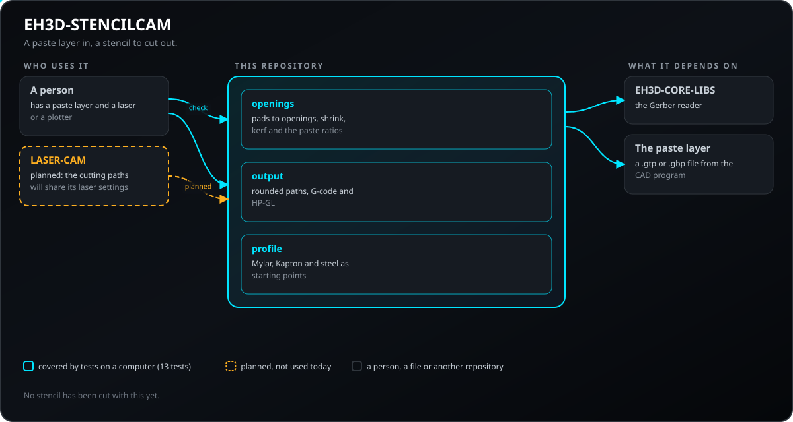
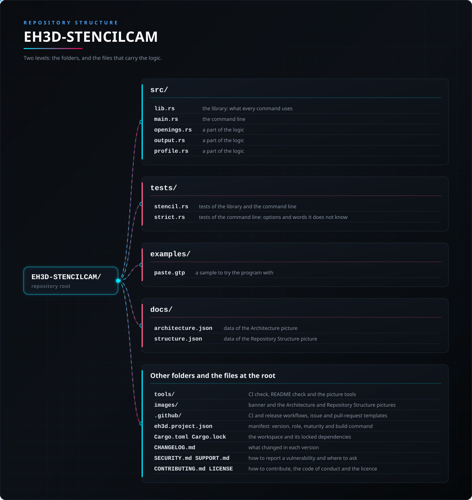

<p align="center">
  
</p>

#  EH3D-STENCILCAM
<p align="center"><a href="README.md">🇺🇸 English</a> | <a href="README_spa.md">🇪🇸 Español</a> | 🇫🇷 <b>Français</b> | <a href="README_ita.md">🇮🇹 Italiano</a> | <a href="README_deu.md">🇩🇪 Deutsch</a> | <a href="README_zho.md">🇨🇳 中文</a> | <a href="README_jpn.md">🇯🇵 日本語</a> | <a href="README_por.md">🇵🇹 Português</a></p>

### Pochoirs de pâte à braser depuis la couche de pâte : ouvertures, contrôle des rapports et trajets de découpe

<p align="center">
  
  
  
  
  
</p>

---

**Vérification d'honnêteté - ce qui fonctionne aujourd'hui :** une bibliothèque Rust et un programme en ligne de commande (`eh3d-stencilcam`) avec 117 tests exécutés sur un ordinateur : transforme les pastilles d'une couche de pâte en ouvertures de pochoir (réduites, arrondies, compensées du kerf du laser et vérifiées pour la libération de la pâte) et les écrit en G-code ou HP-GL. Il a une fenêtre (compilée avec `--features gui`) qui ouvre une couche de pâte et dessine les pastilles et les trajets de coupe, mais qui n'a pas encore été vue sur un écran ; il n'a pas été essayé sur une machine et n'a pas été vérifié sur une collection de fichiers réels.

---

> **État de sécurité :** ce programme ne commande aucune machine et n'est pas un système de sécurité. Ce qu'il produit doit être vérifié par une personne avant tout essai sur une machine ; rien ici n'a fonctionné sur du matériel réel.


## 📋 En un coup d'œil

| | |
|---|---|
| Version | `0.0.4` |
| Maturité | Échafaudage |
| Tests | 117 |
| Pile technique | Rust |
| Sur du matériel réel | Non essayé : rien ici n'a fonctionné sur une machine |

**Aller à  :** [Présentation](#-présentation) · [Architecture](#-architecture) · [Démarrage rapide](#-démarrage-rapide) · [Tests](#-tests) · [Structure](#-structure-du-dépôt) · [Liés](#-projets-liés)

## 🚦 État du projet

Chaque ligne est une partie de ce dépôt et le feu dit où elle en est aujourd'hui. Elle est écrite d'après ce que le dépôt peut montrer (tests, compilations, exécutions), pas d'après ce qui est prévu.

🟢 Fait et vérifié · 🟡 Fonctionne, avec des limites connues · 🟠 À moitié fait ou pas encore vérifié · 🔴 Pas fait ou ne fonctionne pas

| Domaine | État | Ce que cela veut dire ici |
|---|---|---|
| Cœur | 🟡 | transforme les pastilles d'une couche de pâte en ouvertures de pochoir (réduites, arrondies, compensées du kerf du laser et vérifiées pour la libération de la pâte) et les écrit en G-code ou HP-GL ; testé sur un ordinateur avec des entrées normales et abîmées, pas avec une collection de fichiers réels. |
| Ligne de commande | 🟡 | `eh3d-stencilcam` exécute les mêmes fonctions que la bibliothèque et affiche le résultat ; chaque erreur revient sous forme de message et de code de sortie non nul. |
| Tests | 🟡 | 117 tests passent (`cargo test`), avec des cas normaux, des cas limites et des entrées abîmées. |
| Sécurité | 🟡 | Rust sûr et simple (`forbid(unsafe_code)`) : rien ne panique sur les fichiers reçus et une mauvaise valeur est une erreur avec sa raison ; pas de revue indépendante. |
| Fenêtre | 🟠 | Écrite (egui, `--features gui`) : ouvrir ou déposer une couche de pâte, choisir le matériau, modifier les paramètres, voir les pastilles et les trajets de coupe (en rouge les ouvertures qui ne libéreront pas la pâte), zoom et déplacement, exporter ; sa logique est testée, mais elle n'a pas encore été compilée ni vue sur un écran. |
| Matériel réel | 🔴 | Non essayé : rien ici n'a été exécuté sur une machine. |
| Documentation | 🟡 | README en huit langues, le journal des modifications et les deux images dessinées depuis `docs/`. |

## 🎯 Présentation

* **Les ouvertures** (`src/openings.rs`) : chaque pastille flashée dans la couche de pâte (rectangulaire, ronde ou oblongue, en millimètres quelles que soient les unités du fichier) est une ouverture ; elle est réduite du pourcentage du matériau et la ligne de coupe est rendue plus petite du kerf du laser pour que le trou ait la taille demandée. Un pochoir pour la face inférieure peut être inversé en miroir.
* **Les rapports** (`src/openings.rs`) : le rapport d'aspect (le petit côté sur l'épaisseur de la feuille, au moins 1,5) et le rapport de surface (la surface de l'ouverture sur celle de ses parois, au moins 0,66) disent si la pâte quittera l'ouverture ; une ouverture qui échoue est signalée avec sa position et `convert` refuse d'écrire tant qu'on ne l'a pas regardée (ou `--force`).
* **Les trajets** (`src/output.rs`, `src/profile.rs`) : rectangles arrondis, cercles et oblongs en trajets fermés dans l'ordre d'un parcours au plus proche ; G-code pour un laser à puissance constante, éteint pendant les déplacements, ou HP-GL à 40 unités au millimètre ; profils Mylar, Kapton et acier avec épaisseur, réduction, rayon de coin et kerf comme points de départ.
* **Un pochoir incomplet n'est pas écrit :** `convert` refuse d'écrire le fichier quand la couche a des pastilles, des pistes ou des régions qui ne peuvent pas devenir des ouvertures (polygones, macros, régions), sauf avec `--force`.
* **La couche est lue depuis ses octets :** `--max-bytes N` refuse un fichier au-dessus de la limite (256 MiB par défaut) ; le texte qui n'est pas en UTF-8 est lu comme du Latin-1 avec un avertissement. Les avertissements et erreurs du lecteur sont affichés avec leur code stable et `--hide CODE[,CODE]` omet les avis de ces codes ; une erreur du lecteur compte comme une partie perdue de la couche, donc `convert` refuse sauf avec `--force`. Les ouvertures viennent de la conversion des ouvertures de EH3D-GERBERVIEWER, et une pastille polygonale est découpée comme un cercle (avec une note, donc `convert` refuse aussi sauf avec `--force`). `--arc-tolerance MM` fixe la précision des arcs, et le refus d'un fichier trop grand est écrit dans la langue du système.

## 🧩 Rôle dans EH3D

EH3D-STENCILCAM est un programme de l'EH3D Fabrication Suite. Il fonctionne comme bibliothèque et ligne de commande et, compilé avec `--features gui`, comme fenêtre avec l'aspect commun aux autres programmes de la suite. Il lit et écrit des fichiers simples et peut donc s'utiliser seul ou entre les autres programmes.

## 🏛️ Architecture

<p align="center">
  
</p>


Comment les parties de ce dépôt s'articulent : qui l'utilise, ce qu'il contient et de quoi il dépend. L'image est dessinée depuis `docs/architecture.json` et vérifiée avec le code.

## ✨ Fonctionnalités

* **Une bibliothèque et une ligne de commande :** chaque commande de `eh3d-stencilcam` est une fonction de la bibliothèque ; un autre programme de la suite peut l'appeler sans lancer de processus.
* **Ligne de commande stricte :** une option mal écrite (`--powr`) ou un mot en trop est une erreur qui la nomme, et non quelque chose d'ignoré ; sinon le programme ferait sa sortie avec les valeurs par défaut.
* **Tests avec entrées abîmées :** les tests fournissent aussi des fichiers vides, du bruit, des nombres énormes et des fichiers coupés, et aucun ne doit paniquer.
* **Sans deviner :** une valeur absurde est une erreur qui dit laquelle et pourquoi, jamais un résultat qui n'en a que l'air.
* **Pas de code unsafe :** `#![forbid(unsafe_code)]` dans la bibliothèque et le programme.
* **Le G-code porte l'en-tête standard et un ordre plus rapide :** le fichier commence par des lignes de commentaire pour le générateur, les unités et la couche avec son SHA-256, un rectangle à angles vifs n'a pas de points répétés, et l'ordre des découpes est trouvé avec une grille, si bien que cent mille ouvertures sont ordonnées en un instant.
* **Une attente après l'allumage du laser :** `--laser-wait SECONDES` écrit une attente `G4` après chaque `M3` pour que le laser soit à sa puissance avant que la tête ne bouge (0 par défaut : pas d'attente) ; les tests relisent le G-code avec le lecteur de la suite et ne trouvent aucun avertissement ni aucune coupe laser éteint.

## 🔒 Sécurité et protection

| Menace | Défense |
|---|---|
| Un fichier abîmé, coupé ou vide | pas de panique : les tests coupent une entrée valide à chaque position et fournissent du bruit |
| Un nombre absurde (négatif, non fini, démesuré) | refusé avec une erreur qui nomme la valeur ; rien n'est arrondi en quelque chose de plausible |
| Usage non sûr de la mémoire | Rust sûr et simple avec `forbid(unsafe_code)` |

**Ce qui n'est pas défendu :** un résultat produit sans erreur n'est pas un résultat vérifié. Rien ici ne connaît les limites d'une machine et le programme n'a pas eu de revue indépendante. Signalez une vulnérabilité en privé (voir [SECURITY.md](SECURITY.md)).

## 🔌 Interfaces

La bibliothèque est `eh3d_stencilcam` (`use eh3d_stencilcam::...`) ; la ligne de commande est `eh3d-stencilcam`. Les commandes sont celles-ci ; chacune affiche son résultat sur la sortie standard et signale une erreur sur la sortie d'erreur avec un code de sortie non nul. Il n'y a pas d'accès réseau.

```text
EH3D-STENCILCAM/
├── src/
│   ├── browse.rs                                la liste des fichiers de la fenêtre d'ouverture d'un fichier
│   ├── cli_args.rs                              les arguments de la ligne de commande, le même fichier dans chaque petit utilitaire
│   ├── gui.rs                                   la fenêtre (egui, avec la fonctionnalité gui) : dessine l'état et transmet ce que fait la personne
│   ├── lang.rs                                  les mots de la fenêtre dans les huit langues
│   ├── layer.rs                                 lit une couche depuis des octets et montre ce que dit le lecteur par son code
│   ├── lib.rs                                   la bibliothèque : ce que chaque commande utilise
│   ├── main.rs                                  la ligne de commande
│   ├── openings.rs                              une partie de la logique
│   ├── output.rs                                une partie de la logique
│   ├── profile.rs                               une partie de la logique
│   ├── viewport.rs                              zoom et déplacement de l'image, en simples nombres
│   └── window.rs                                l'état de la fenêtre sans écran : couche, matériau, paramètres, coupes, export et état
├── tests/
│   ├── reading.rs                               tests de lecture des fichiers : la limite de taille, le texte non UTF-8, les avis par code
│   ├── readme.rs                                tests qui exécutent ce que promettent le README et les scripts run
│   ├── stencil.rs                               tests de la bibliothèque et de la ligne de commande
│   ├── strict.rs                                tests de la ligne de commande : options et mots qu'elle ne connaît pas
│   └── window_cli.rs                            tests qu'une compilation sans la fonctionnalité gui reste une ligne de commande
├── examples/
│   └── paste.gtp                                un exemple pour essayer le programme
├── docs/
│   ├── architecture.json                        données de l'image d'Architecture
│   └── structure.json                           données de l'image de Structure
├── tools/                                       contrôle de la CI et du README et outils d'images
├── images/                                      bannière et images d'Architecture et de Structure du dépôt
├── .github/                                     workflows de CI et de publication, modèles d'issues et de pull requests
├── eh3d.project.json                            manifeste : version, rôle, maturité et commande de compilation
├── Cargo.toml Cargo.lock                        le workspace et ses dépendances verrouillées
├── rust-toolchain.toml                          la toolchain Rust épinglée
├── CHANGELOG.md                                 ce qui a changé dans chaque version
├── SECURITY.md SUPPORT.md                       signaler une vulnérabilité et poser des questions
└── CONTRIBUTING.md CODE_OF_CONDUCT.md LICENSE   contribuer, code de conduite et licence
```

## ⚙️ Configuration

Il n'y a pas encore de fichier de configuration : ce que la personne choisit est donné en arguments de la ligne de commande (voir Interfaces) et chaque valeur par défaut est écrite dans l'aide de la commande (`eh3d-stencilcam help`). Les limites fixes sont des constantes nommées dans le code, couvertes par des tests.

## 🚀 Démarrage rapide

Il faut une chaîne d'outils Rust stable (1.75 ou plus récente).

```bash
cargo build --release
cargo test
cargo run --release -- check examples/paste.gtp
cargo run --release --features gui   # the window
```

## 🧪 Tests

La suite compte 117 tests (`cargo test`, exécutés sous Windows et Linux dans le CI). Ils vérifient les cas normaux, les cas limites et les entrées abîmées : fichiers vides, bruit et fichiers coupés ne font jamais paniquer. Le CI exécute aussi `cargo fmt --check`, `cargo clippy` avec les avertissements comme erreurs et `python -I tools/ci_validate.py`.

## 🏗️ Compilation et publication

La version se trouve dans `Cargo.toml` et `eh3d.project.json` ; chaque version a son entrée dans [CHANGELOG.md](CHANGELOG.md). `build.bat` / `build.sh` compilent le programme, `test.bat` / `test.sh` lancent les tests et `run.bat` / `run.sh` l'exécutent avec un exemple. Les versions sont publiées sur GitHub.

### Téléchargements

Chaque version contient le programme avec sa fenêtre pour Windows (64 et 32 bits), Linux (64 bits) et macOS (Apple silicon et Intel), sous la forme `<nom>-<version>-<système>.zip` (Windows) ou `.tar.gz` avec le programme, la licence, le lisez-moi, l'icône et les exemples. Les fichiers sont construits par GitHub Actions, listés dans `SHA256SUMS` et signés avec la clé d'EH3D. Pour vérifier un téléchargement, comparez son empreinte avec le fichier `.sha256` qui l'accompagne (`sha256sum -c`) et vérifiez sa signature avec le fichier `.sig` qui l'accompagne (`ssh-keygen -Y verify`).

## 📂 Structure du dépôt

<p align="center">
  
</p>

<details>
<summary>Version texte de l'arborescence</summary>

```text
EH3D-STENCILCAM/
├── src/
│   ├── browse.rs                                la liste des fichiers de la fenêtre d'ouverture d'un fichier
│   ├── cli_args.rs                              les arguments de la ligne de commande, le même fichier dans chaque petit utilitaire
│   ├── gui.rs                                   la fenêtre (egui, avec la fonctionnalité gui) : dessine l'état et transmet ce que fait la personne
│   ├── lang.rs                                  les mots de la fenêtre dans les huit langues
│   ├── layer.rs                                 lit une couche depuis des octets et montre ce que dit le lecteur par son code
│   ├── lib.rs                                   la bibliothèque : ce que chaque commande utilise
│   ├── main.rs                                  la ligne de commande
│   ├── openings.rs                              une partie de la logique
│   ├── output.rs                                une partie de la logique
│   ├── profile.rs                               une partie de la logique
│   ├── viewport.rs                              zoom et déplacement de l'image, en simples nombres
│   └── window.rs                                l'état de la fenêtre sans écran : couche, matériau, paramètres, coupes, export et état
├── tests/
│   ├── reading.rs                               tests de lecture des fichiers : la limite de taille, le texte non UTF-8, les avis par code
│   ├── readme.rs                                tests qui exécutent ce que promettent le README et les scripts run
│   ├── stencil.rs                               tests de la bibliothèque et de la ligne de commande
│   ├── strict.rs                                tests de la ligne de commande : options et mots qu'elle ne connaît pas
│   └── window_cli.rs                            tests qu'une compilation sans la fonctionnalité gui reste une ligne de commande
├── examples/
│   └── paste.gtp                                un exemple pour essayer le programme
├── docs/
│   ├── architecture.json                        données de l'image d'Architecture
│   └── structure.json                           données de l'image de Structure
├── tools/                                       contrôle de la CI et du README et outils d'images
├── images/                                      bannière et images d'Architecture et de Structure du dépôt
├── .github/                                     workflows de CI et de publication, modèles d'issues et de pull requests
├── eh3d.project.json                            manifeste : version, rôle, maturité et commande de compilation
├── Cargo.toml Cargo.lock                        le workspace et ses dépendances verrouillées
├── rust-toolchain.toml                          la toolchain Rust épinglée
├── CHANGELOG.md                                 ce qui a changé dans chaque version
├── SECURITY.md SUPPORT.md                       signaler une vulnérabilité et poser des questions
└── CONTRIBUTING.md CODE_OF_CONDUCT.md LICENSE   contribuer, code de conduite et licence
```

</details>

## 🗺️ Feuille de route et limites connues

**Limites connues aujourd'hui**

* La fenêtre n'a pas encore été vue sur un écran et n'affiche pas les rapports de chaque ouverture : c'est le rôle de `check`.
* Il n'a été essayé ni sur une machine ni avec une collection de fichiers réels, et n'a pas eu de revue indépendante.
* Les pastilles macro et les pistes et régions de la couche de pâte ne sont pas transformées en ouvertures (une pastille polygonale est découpée comme un cercle), les profils des matériaux sont des points de départ et il n'y a pas de découpe en plusieurs passes pour une feuille d'acier.

**Ensuite**

* L'essayer avec une vraie couche de pâte et un laser et lire les profils dans le magasin d'outils.
* Voir la fenêtre sur un écran et la compléter : les profils du magasin d'outils et une vue des rapports de pâte de chaque ouverture.
* L'essayer avec des fichiers réels et avec les autres programmes de la suite.

## 🌍 Langues

Le README et les textes existent en anglais, espagnol, français, italien, allemand, chinois, japonais et portugais européen.

## 🔗 Projets liés

* [EH3D-CORE-LIBS](https://github.com/JuanenRac/EH3D-CORE-LIBS): les lecteurs de Gerber, Excellon et G-code
* [EH3D-PHOENIX-LASER](https://github.com/JuanenRac/EH3D-PHOENIX-LASER): la gravure et la découpe laser
* [EH3D-GERBERVIEWER](https://github.com/JuanenRac/EH3D-GERBERVIEWER): le visualiseur de couches Gerber
* [EH3D-TOOL-MANAGER](https://github.com/JuanenRac/EH3D-TOOL-MANAGER): le magasin d'outils partagé par les programmes CAM
* [EH3D-CAM-DEBUGGER](https://github.com/JuanenRac/EH3D-CAM-DEBUGGER): la vérification du G-code avant qu'il n'atteigne une machine

## 📚 Documentation

* [Journal des modifications](CHANGELOG.md)
* [Données d'architecture et de structure](docs/architecture.json) : les données qui servent à dessiner les deux images.

## 🤝 Contribuer et communauté

* Avant une pull request, lancez `cargo fmt --check`, `cargo clippy --all-targets -- -D warnings`, `cargo test` et `python -I tools/ci_validate.py` : tout doit passer. Voir [CONTRIBUTING.md](CONTRIBUTING.md) et le [code de conduite](CODE_OF_CONDUCT.md).
* Le README existe en huit langues : un changement de texte se fait dans les huit fichiers, et les deux images sont dessinées depuis `docs/architecture.json` et `docs/structure.json` par `tools/make_architecture.py` et `tools/make_structure.py`.
* Signalez une vulnérabilité en privé : [SECURITY.md](SECURITY.md). Questions, idées et rapports : electrohobby3d@gmail.com ([SUPPORT.md](SUPPORT.md)).

## 👤 AUTEUR

**JuanenRac (Electro Hobby 3D)** · electrohobby3d@gmail.com

## 📜 LICENCE

Logiciel : GPL-3.0-or-later. Voir [LICENSE](LICENSE). Les conceptions matérielles de la suite utilisent la CERN OHL-S.
