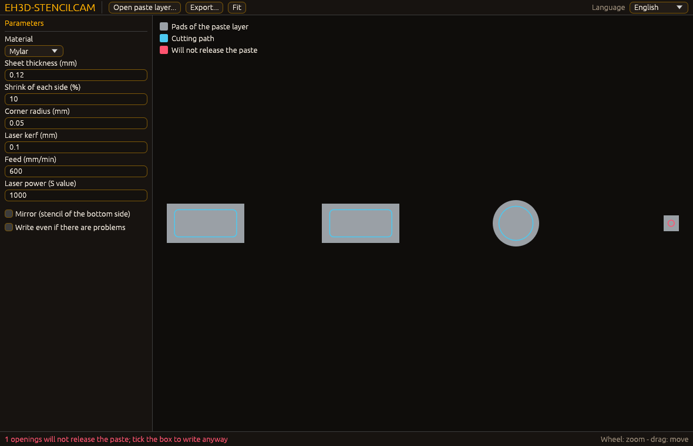

<p align="center">
  
</p>

#  EH3D-STENCILCAM
<p align="center"><a href="README.md">🇺🇸 English</a> | <a href="README_spa.md">🇪🇸 Español</a> | <a href="README_fra.md">🇫🇷 Français</a> | 🇮🇹 <b>Italiano</b> | <a href="README_deu.md">🇩🇪 Deutsch</a> | <a href="README_zho.md">🇨🇳 中文</a> | <a href="README_jpn.md">🇯🇵 日本語</a> | <a href="README_por.md">🇵🇹 Português</a></p>

### Stencil per pasta saldante dal livello di pasta: aperture, controllo dei rapporti e percorsi di taglio

<p align="center">
  
  
  
  
  
</p>

---

**Verifica di onestà - cosa funziona oggi:** una libreria Rust e un programma a riga di comando (`eh3d-stencilcam`) con 173 test eseguiti su un computer: trasforma i pad di un livello di pasta in aperture di stencil (ridotte, arrotondate, compensate per il kerf del laser e verificate per il rilascio della pasta) e le scrive come G-code o HP-GL. Ha una finestra (compilata con `--features gui`) che apre un livello pasta e disegna i pad e i percorsi di taglio, ma che non è ancora stata vista su uno schermo; non è stato provato su una macchina e non è stato verificato su una raccolta di file reali.

---

> **Stato di sicurezza:** questo programma non controlla alcuna macchina e non è un sistema di sicurezza. Ciò che produce deve essere controllato da una persona prima di eseguire qualsiasi cosa su una macchina; nulla di questo ha girato su hardware reale.


## 📋 In breve

| | |
|---|---|
| Versione | `0.0.6` |
| Maturità | Impalcatura |
| Test | 173 |
| Stack tecnologico | Rust |
| Su hardware reale | Non provato: nulla di questo ha girato su una macchina |

**Vai a:** [Panoramica](#-panoramica) · [Architettura](#-architettura) · [Avvio rapido](#-avvio-rapido) · [Test](#-test) · [Struttura](#-struttura-del-repository) · [Correlati](#-progetti-correlati)

## 🚦 Stato del progetto

Ogni riga è una parte di questo repository e il semaforo dice a che punto è oggi. È scritta in base a ciò che il repository può mostrare (test, compilazioni, esecuzioni), non a ciò che è previsto.

🟢 Fatto e verificato · 🟡 Funziona, con limiti noti · 🟠 Fatto a metà o non ancora verificato · 🔴 Non fatto o non funzionante

| Area | Stato | Cosa significa qui |
|---|---|---|
| Nucleo | 🟡 | trasforma i pad di un livello di pasta in aperture di stencil (ridotte, arrotondate, compensate per il kerf del laser e verificate per il rilascio della pasta) e le scrive come G-code o HP-GL; provato su un computer con input normali e danneggiati, non con una raccolta di file reali. |
| Riga di comando | 🟡 | `eh3d-stencilcam` esegue le stesse funzioni della libreria e stampa il risultato; ogni errore torna come messaggio e codice di uscita diverso da zero. |
| Test | 🟡 | 173 test passano (`cargo test`), con casi normali, casi limite e input danneggiati. |
| Sicurezza | 🟡 | Rust sicuro e semplice (`forbid(unsafe_code)`): nulla va in panico con i file ricevuti e un valore errato è un errore con il suo motivo; nessuna revisione indipendente. |
| Finestra | 🟠 | Scritta (egui, `--features gui`): aprire o trascinare un livello pasta, scegliere il materiale, modificare i parametri, vedere i pad e i percorsi di taglio (in rosso le aperture che non rilasceranno la pasta), zoom e spostamento, esportare; la sua logica è testata, ma non è ancora stata compilata né vista su uno schermo. |
| Hardware reale | 🔴 | Non provato: nulla di questo è stato eseguito su una macchina. |
| Documentazione | 🟡 | README in otto lingue, il changelog e le due immagini disegnate da `docs/`. |

## 🎯 Panoramica

* **Le aperture** (`src/openings.rs`): ogni pad flashato nel livello di pasta (rettangolare, tondo od ovale, in millimetri qualunque siano le unità del file) è un'apertura; viene ridotta della percentuale del materiale e la linea di taglio è resa più piccola del kerf del laser perché il foro esca della misura chiesta. Uno stencil per il lato inferiore può essere specchiato.
* **I rapporti** (`src/openings.rs`): il rapporto d'aspetto (il lato piccolo sullo spessore del foglio, almeno 1,5) e il rapporto d'area (l'area dell'apertura sull'area delle sue pareti, almeno 0,66) dicono se la pasta uscirà dall'apertura; un'apertura che non li rispetta è segnalata con la sua posizione e `convert` rifiuta di scrivere finché non la si guarda (o `--force`).
* **I percorsi** (`src/output.rs`, `src/profile.rs`): rettangoli arrotondati, cerchi e ovali come percorsi chiusi nell'ordine di un giro al più vicino; G-code per un laser a potenza costante, spento negli spostamenti, o HP-GL a 40 unità al millimetro; profili per Mylar, Kapton e acciaio con spessore, riduzione, raggio degli angoli e kerf come punti di partenza.
* **Una maschera incompleta non viene scritta:** `convert` rifiuta di scrivere il file quando lo strato ha pad, piste o regioni che non possono diventare aperture (poligoni, macro, regioni), salvo con `--force`.
* **Lo strato viene letto dai suoi byte:** `--max-bytes N` rifiuta un file oltre il limite (256 MiB di default); il testo che non è UTF-8 viene letto come Latin-1 con un avviso. Gli avvisi e gli errori del lettore sono stampati con il loro codice stabile e `--hide CODE[,CODE]` omette gli avvisi di quei codici; un errore del lettore conta come una parte persa dello strato, quindi `convert` rifiuta salvo con `--force`. Le aperture vengono dalla conversione delle aperture di EH3D-GERBERVIEWER, e un pad poligonale viene tagliato come un cerchio (con una nota, quindi anche questo `convert` lo rifiuta salvo con `--force`). `--arc-tolerance MM` stabilisce la precisione degli archi, e il rifiuto di un file troppo grande è scritto nella lingua del sistema.

## 🧩 Ruolo in EH3D

EH3D-STENCILCAM è un programma della EH3D Fabrication Suite. Funziona come libreria e riga di comando e, compilato con `--features gui`, come finestra con l'aspetto comune agli altri programmi della suite. Legge e scrive file semplici, quindi può essere usato da solo o tra gli altri programmi.

## 🏛️ Architettura

<p align="center">
  
</p>


Come si incastrano le parti di questo repository: chi lo usa, cosa contiene e da cosa dipende. L'immagine è disegnata da `docs/architecture.json` e verificata con il codice.

## 🖼️ Schermate

<p align="center">
  
</p>

<p align="center"><em>La finestra con lo strato di pasta di esempio: i pad, il percorso di taglio di ogni apertura e l'apertura che non rilascerà la pasta, con il suo avviso in basso.</em></p>

## ✨ Funzionalità

* **Libreria e riga di comando:** ogni comando di `eh3d-stencilcam` è una funzione della libreria, così un altro programma della suite può chiamarla senza avviare un processo.
* **Riga di comando rigorosa:** un'opzione scritta male (`--powr`) o una parola in più è un errore che la nomina, non qualcosa da ignorare; altrimenti il programma farebbe la sua uscita con i valori predefiniti.
* **Test con input danneggiati:** i test forniscono anche file vuoti, spazzatura, numeri enormi e file tagliati, e nessuno può andare in panico.
* **Nessuna ipotesi:** un valore privo di senso è un errore che dice quale e perché, mai un risultato che sembra solo giusto.
* **Il programma per il laser non resta mai scritto a metà:** il file G-code o HP-GL si scrive, nella riga di comando e nella finestra, in un file temporaneo accanto a quello vero e vi si rinomina sopra, così un'interruzione o un disco pieno lasciano intero il file precedente e non un programma che si ferma a metà di un taglio. Se fallisce, il temporaneo viene rimosso e l'errore inizia con il codice `file_unwritable` e il nome del file.
* **Nessun codice unsafe:** `#![forbid(unsafe_code)]` nella libreria e nel programma.
* **Il G-code porta l'intestazione standard e un ordine più veloce:** il file inizia con righe di commento per il generatore, le unità e il livello con il suo SHA-256, un rettangolo a spigoli vivi non ha punti ripetuti e l'ordine dei tagli si trova con una griglia, così centomila aperture sono ordinate in un attimo.
* **Un'attesa dopo l'accensione del laser:** `--laser-wait SECONDI` scrive un'attesa `G4` dopo ogni `M3` perché il laser sia alla sua potenza prima che la testa si muova (0 per impostazione predefinita: nessuna attesa); i test rileggono il G-code con il lettore della suite e non trovano alcun avviso né alcun taglio con il laser spento. `--rapid MM_MIN` (o `rapid_mm_min` in `stencil.cfg`, da 100 a 100000, 0 per impostazione predefinita: nessuna stima) è la velocità dei movimenti con il laser spento: `convert` stampa allora il tempo stimato del lavoro in G-code (taglio, attesa del laser e spostamenti; l'accelerazione della macchina non è conteggiata).
* **Un tratto retto di ingresso e di uscita su ogni taglio:** il G-code può entrare in ogni contorno lungo una retta tangente al suo primo segmento e uscirne lungo il prolungamento dell'ultimo (0,3 mm ciascuno per impostazione predefinita, `--lead-in MM`, `--lead-out MM` oppure `lead_in_mm` e `lead_out_mm` in `stencil.cfg`; 0 non ne scrive e il programma è quello scritto senza tratti). Il laser resta spento mentre la testa va all'inizio dell'ingresso, si accende lì (e attende, se richiesto) e si spegne alla fine dell'uscita. I contorni sono convessi e girano in senso antiorario, quindi entrambi i tratti stanno fuori dall'apertura, sul foglio che si conserva; in HP-GL non se ne scrive nessuno.
* **Ingresso e uscita per forma:** un'apertura rotonda e una rettangolare possono avere il proprio ingresso e la propria uscita (`--lead-in-round MM`, `--lead-out-round MM`, `--lead-in-rect MM`, `--lead-out-rect MM` oppure `lead_in_round_mm`, `lead_out_round_mm`, `lead_in_rect_mm`, `lead_out_rect_mm` in `stencil.cfg`, da 0 a 5 mm); quella non indicata è la generale `--lead-in` o `--lead-out`, e un'apertura oblunga usa sempre le generali. La stima del tempo conta quelle di ciascuna forma. Vedi `docs/leads-by-form.md`.
* **Un disegno come ingresso, e velocità, scala del laser e passate in `stencil.cfg`:** un file che termina con `.dxf` viene letto come disegno (i cerchi diventano aperture rotonde e i rettangoli chiusi con i lati sugli assi aperture rettangolari; si legge l'unità del disegno e ogni altra entità è un avviso, per cui `convert` rifiuta di scrivere senza `--force`); `--feed`, `--smax` e `--passes` (`feed_mm_min`, `smax` e `passes` nel file; di default 600 mm/min, 1000 e una passata) fissano la velocità del taglio, il fondo scala della potenza del laser e quante volte si taglia ogni contorno. Provato solo sul computer: nulla è stato tagliato con un laser.

## 🔒 Sicurezza e protezione

| Minaccia | Difesa |
|---|---|
| Un file danneggiato, tagliato o vuoto | nessun panico: i test tagliano un input valido in ogni posizione e forniscono spazzatura |
| Un numero privo di senso (negativo, non finito, assurdamente grande) | rifiutato con un errore che nomina il valore; nulla viene arrotondato in qualcosa di plausibile |
| Uso non sicuro della memoria | Rust sicuro e semplice con `forbid(unsafe_code)` |

**Cosa non è difeso:** un risultato prodotto senza errori non è un risultato verificato. Nulla qui conosce i limiti di una macchina e il programma non ha avuto revisione indipendente. Segnalate una vulnerabilità in privato (vedi [SECURITY.md](SECURITY.md)).

## 🔌 Interfacce

La libreria è `eh3d_stencilcam` (`use eh3d_stencilcam::...`); la riga di comando è `eh3d-stencilcam`. I comandi sono questi; ciascuno stampa il risultato sull'output standard e segnala un errore sull'output di errore con un codice di uscita diverso da zero. Non c'è accesso alla rete.

```text
EH3D-STENCILCAM/
├── src/
│   ├── browse.rs                                l'elenco dei file della finestra che apre un file
│   ├── cli_args.rs                              gli argomenti della riga di comando, lo stesso file in ogni piccola utilità
│   ├── config.rs                                il file delle impostazioni: ingresso e uscita dei tagli e l'attesa del laser
│   ├── dxf_in.rs                                legge un disegno (DXF): cerchi e rettangoli diventano aperture, il resto è un avviso
│   ├── gui.rs                                   la finestra (egui, con la funzione gui): disegna lo stato e inoltra ciò che fa la persona
│   ├── lang.rs                                  le parole della finestra nelle otto lingue
│   ├── layer.rs                                 legge un livello dai byte e mostra ciò che dice il lettore tramite il suo codice
│   ├── lib.rs                                   la libreria: ciò che usa ogni comando
│   ├── main.rs                                  la riga di comando
│   ├── openings.rs                              una parte della logica
│   ├── output.rs                                una parte della logica
│   ├── profile.rs                               una parte della logica
│   ├── shot.rs                                  la modalità immagine della finestra (--shot): i suoi argomenti, letti e verificati senza schermo
│   ├── viewport.rs                              zoom e spostamento dell'immagine, in semplici numeri
│   └── window.rs                                lo stato della finestra senza schermo: livello, materiale, parametri, tagli, esportazione e stato
├── tests/
│   ├── dxf.rs                                   test del disegno DXF, della velocità, della scala del laser e delle passate del taglio
│   ├── estimate.rs                              test del tempo stimato di un lavoro e della velocità rapida delle impostazioni
│   ├── lead_forms.rs                            test di ingresso e uscita per forma dell'apertura e delle loro impostazioni
│   ├── leads.rs                                 test dell'ingresso e dell'uscita retti dei tagli e del file delle impostazioni
│   ├── reading.rs                               test di lettura dei file: il limite di dimensione, testo non UTF-8, avvisi per codice
│   ├── readme.rs                                test che eseguono ciò che promettono il README e gli script run
│   ├── stencil.rs                               test della libreria e della riga di comando
│   ├── strict.rs                                test della riga di comando: opzioni e parole che non conosce
│   ├── atomic_write.rs                          test della scrittura tramite un file temporaneo rinominato
│   └── window_cli.rs                            test che una compilazione senza la funzione gui resti una riga di comando
├── examples/
│   ├── paste.gtp                                un esempio per provare il programma
│   └── paste.dxf                                gli stessi pad come disegno (DXF)
├── docs/
│   ├── leads-by-form.md                         ingresso e uscita per forma, con valori calcolati
│   ├── architecture.json                        dati dell'immagine di Architettura
│   └── structure.json                           dati dell'immagine di Struttura
├── tools/                                       controllo della CI e del README e strumenti per le immagini
├── images/                                      banner e le immagini di Architettura e Struttura del repository
├── .github/                                     workflow di CI e di rilascio, modelli di issue e pull request
├── eh3d.project.json                            manifesto: versione, ruolo, maturità e comando di compilazione
├── Cargo.toml Cargo.lock                        il workspace e le sue dipendenze bloccate
├── rust-toolchain.toml                          la toolchain Rust fissata
├── CHANGELOG.md                                 cosa è cambiato in ogni versione
├── SECURITY.md SUPPORT.md                       come segnalare una vulnerabilità e dove chiedere
└── CONTRIBUTING.md CODE_OF_CONDUCT.md LICENSE   come contribuire, codice di condotta e licenza
```

## ⚙️ Configurazione

Un piccolo file di impostazioni, `stencil.cfg` (`chiave = valore`, uno per riga, `#` inizia un commento), contiene ciò che vale la pena regolare: `lead_in_mm` e `lead_out_mm`, la lunghezza del tratto retto di ingresso prima di ogni contorno e di uscita dopo (0,3 mm per impostazione predefinita, da 0 a 5; 0 non ne scrive), e `laser_wait_s`, l'attesa dopo l'accensione del laser (0 per impostazione predefinita, fino a 60). `eh3d-stencilcam config` stampa il file con ogni valore predefinito (`examples/stencil.cfg` è quel file) e `--config FILE` ne legge uno; `--lead-in MM`, `--lead-out MM` e `--laser-wait SECONDI` danno le stesse impostazioni sulla riga di comando e prevalgono sul file. Una chiave sconosciuta, ripetuta o fuori dal suo intervallo è un errore che indica la sua riga. Il resto si passa come argomenti della riga di comando (vedi Interfacce) e ogni valore predefinito è scritto nella guida del comando (`eh3d-stencilcam help`). I limiti fissi sono costanti con nome nel codice, coperte da test. `lead_in_round_mm`, `lead_out_round_mm`, `lead_in_rect_mm`, `lead_out_rect_mm` (con le opzioni `--lead-in-round`, `--lead-out-round`, `--lead-in-rect` e `--lead-out-rect`) indicano ingresso e uscita delle aperture rotonde e di quelle rettangolari; nel file sono scritte come commenti e, se non sono indicate, si usano le generali `lead_in_mm` e `lead_out_mm`.

## 🚀 Avvio rapido

Serve una toolchain Rust stabile (1.75 o più recente).

```bash
cargo build --release
cargo test
cargo run --release -- check examples/paste.gtp
cargo run --release --features gui   # the window
cargo run --release --features gui -- --shot screen.png examples/paste.gtp   # a picture of the window
```

Per fare un'immagine della finestra senza aprirla a mano, eseguila con `--shot FILE.png` (anche `--size WxH`, `--theme forge|dark|light`, `--wait N`, `--lang CODE`, `--open FILE`, `--replace`): si apre con quella dimensione, salva il PNG, non conserva impostazioni e si chiude da sola (codice di uscita 0 se il file è stato scritto, 1 se no, 2 per argomenti errati).

## 🧪 Test

La suite ha 173 test (`cargo test`, eseguiti su Windows e Linux nella CI). Verificano i casi normali, i casi limite e gli input danneggiati: file vuoti, spazzatura e file tagliati non causano mai un panico. La CI esegue anche `cargo fmt --check`, `cargo clippy` con gli avvisi come errori e `python -I tools/ci_validate.py`.

## 🏗️ Compilazione e rilascio

La versione sta in `Cargo.toml` e in `eh3d.project.json`; ogni versione ha la sua voce in [CHANGELOG.md](CHANGELOG.md). `build.bat` / `build.sh` compilano il programma, `test.bat` / `test.sh` eseguono i test e `run.bat` / `run.sh` lo eseguono con un esempio. Le versioni sono pubblicate su GitHub.

### Download

Ogni versione contiene il programma con la sua finestra per Windows (64 e 32 bit), Linux (64 bit) e macOS (Apple silicon e Intel), come `<nome>-<versione>-<sistema>.zip` (Windows) o `.tar.gz` con il programma, la licenza, il leggimi, l'icona e gli esempi. I file sono costruiti da GitHub Actions, elencati in `SHA256SUMS` e firmati con la chiave di EH3D. Per controllare un download, confronta il suo hash con il file `.sha256` accanto ad esso (`sha256sum -c`) e verifica la firma con il file `.sig` accanto ad esso (`ssh-keygen -Y verify`).

## 📂 Struttura del repository

<p align="center">
  
</p>

<details>
<summary>Versione testuale dell'albero</summary>

```text
EH3D-STENCILCAM/
├── src/
│   ├── browse.rs                                l'elenco dei file della finestra che apre un file
│   ├── cli_args.rs                              gli argomenti della riga di comando, lo stesso file in ogni piccola utilità
│   ├── config.rs                                il file delle impostazioni: ingresso e uscita dei tagli e l'attesa del laser
│   ├── gui.rs                                   la finestra (egui, con la funzione gui): disegna lo stato e inoltra ciò che fa la persona
│   ├── lang.rs                                  le parole della finestra nelle otto lingue
│   ├── layer.rs                                 legge un livello dai byte e mostra ciò che dice il lettore tramite il suo codice
│   ├── lib.rs                                   la libreria: ciò che usa ogni comando
│   ├── main.rs                                  la riga di comando
│   ├── openings.rs                              una parte della logica
│   ├── output.rs                                una parte della logica
│   ├── profile.rs                               una parte della logica
│   ├── shot.rs                                  la modalità immagine della finestra (--shot): i suoi argomenti, letti e verificati senza schermo
│   ├── viewport.rs                              zoom e spostamento dell'immagine, in semplici numeri
│   └── window.rs                                lo stato della finestra senza schermo: livello, materiale, parametri, tagli, esportazione e stato
├── tests/
│   ├── estimate.rs                              test del tempo stimato di un lavoro e della velocità rapida delle impostazioni
│   ├── leads.rs                                 test dell'ingresso e dell'uscita retti dei tagli e del file delle impostazioni
│   ├── reading.rs                               test di lettura dei file: il limite di dimensione, testo non UTF-8, avvisi per codice
│   ├── readme.rs                                test che eseguono ciò che promettono il README e gli script run
│   ├── stencil.rs                               test della libreria e della riga di comando
│   ├── strict.rs                                test della riga di comando: opzioni e parole che non conosce
│   └── window_cli.rs                            test che una compilazione senza la funzione gui resti una riga di comando
├── examples/
│   └── paste.gtp                                un esempio per provare il programma
├── docs/
│   ├── architecture.json                        dati dell'immagine di Architettura
│   └── structure.json                           dati dell'immagine di Struttura
├── tools/                                       controllo della CI e del README e strumenti per le immagini
├── images/                                      banner e le immagini di Architettura e Struttura del repository
├── .github/                                     workflow di CI e di rilascio, modelli di issue e pull request
├── eh3d.project.json                            manifesto: versione, ruolo, maturità e comando di compilazione
├── Cargo.toml Cargo.lock                        il workspace e le sue dipendenze bloccate
├── rust-toolchain.toml                          la toolchain Rust fissata
├── CHANGELOG.md                                 cosa è cambiato in ogni versione
├── SECURITY.md SUPPORT.md                       come segnalare una vulnerabilità e dove chiedere
└── CONTRIBUTING.md CODE_OF_CONDUCT.md LICENSE   come contribuire, codice di condotta e licenza
```

</details>

## 🗺️ Roadmap e limiti noti

**Limiti noti oggi**

* La finestra non è ancora stata vista su uno schermo e non mostra i rapporti di ogni apertura: lo fa `check`.
* Non è stato provato su una macchina né con una raccolta di file reali e non ha avuto revisione indipendente.
* I pad macro e le piste e le regioni del livello di pasta non diventano aperture (un pad poligonale viene tagliato come un cerchio), i profili dei materiali sono punti di partenza e non c'è taglio a più passate per un foglio d'acciaio.

**Prossimi passi**

* Provarlo con un vero livello di pasta e un laser e leggere i profili dal magazzino utensili.
* Vedere la finestra su uno schermo e completarla: i profili del magazzino utensili e una vista dei rapporti di pasta di ogni apertura.
* Provarlo con file reali e con gli altri programmi della suite.

## 🌍 Lingue

Il README e i testi esistono in inglese, spagnolo, francese, italiano, tedesco, cinese, giapponese e portoghese europeo.

## 🔗 Progetti correlati

* [EH3D-CORE-LIBS](https://github.com/JuanenRac/EH3D-CORE-LIBS): i lettori di Gerber, Excellon e G-code
* [EH3D-PHOENIX-LASER](https://github.com/JuanenRac/EH3D-PHOENIX-LASER): incisione e taglio laser
* [EH3D-GERBERVIEWER](https://github.com/JuanenRac/EH3D-GERBERVIEWER): il visualizzatore dei livelli Gerber
* [EH3D-TOOL-MANAGER](https://github.com/JuanenRac/EH3D-TOOL-MANAGER): il magazzino utensili condiviso dai programmi CAM
* [EH3D-CAM-DEBUGGER](https://github.com/JuanenRac/EH3D-CAM-DEBUGGER): il controllo del G-code prima che arrivi a una macchina

## 📚 Documentazione

* [Changelog](CHANGELOG.md)
* [Dati di architettura e struttura](docs/architecture.json): i dati da cui si disegnano le due immagini.

## 🤝 Contribuire e comunità

* Prima di una pull request eseguite `cargo fmt --check`, `cargo clippy --all-targets -- -D warnings`, `cargo test` e `python -I tools/ci_validate.py`: tutto deve passare. Vedi [CONTRIBUTING.md](CONTRIBUTING.md) e il [codice di condotta](CODE_OF_CONDUCT.md).
* Il README esiste in otto lingue: una modifica al testo si fa in tutti e otto i file, e le due immagini sono disegnate da `docs/architecture.json` e `docs/structure.json` con `tools/make_architecture.py` e `tools/make_structure.py`.
* Segnalate una vulnerabilità in privato: [SECURITY.md](SECURITY.md). Domande, idee e segnalazioni: electrohobby3d@gmail.com ([SUPPORT.md](SUPPORT.md)).

## 👤 AUTORE

**JuanenRac (Electro Hobby 3D)** · electrohobby3d@gmail.com

## 📜 LICENZA

Software: GPL-3.0-or-later. Vedi [LICENSE](LICENSE). I progetti hardware della suite usano la CERN OHL-S.
