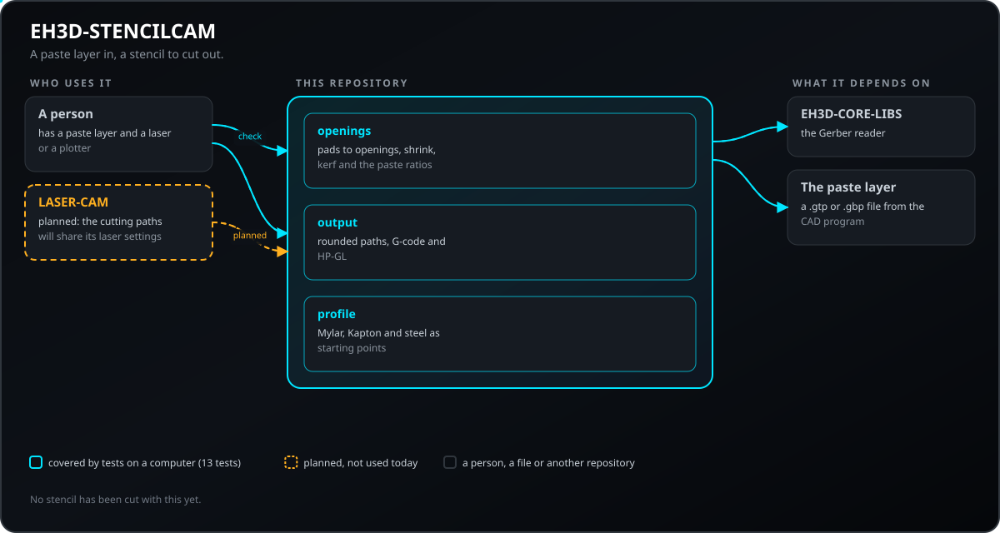
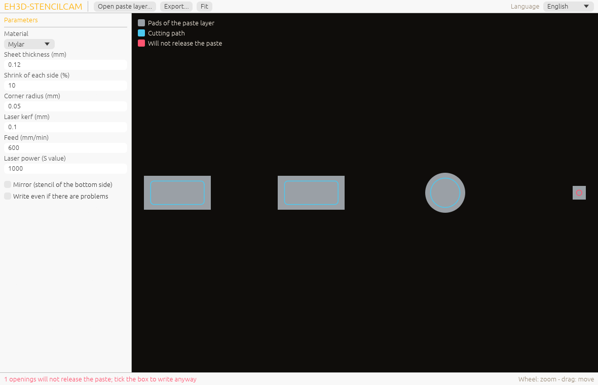
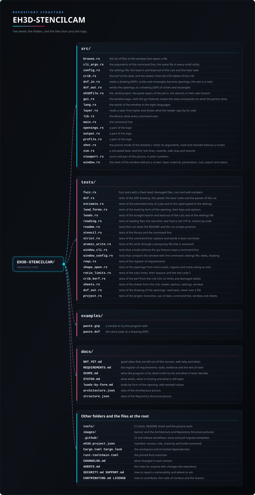

<p align="center">
  
</p>

#  EH3D-STENCILCAM
<p align="center"><a href="README.md">🇺🇸 English</a> | <a href="README_spa.md">🇪🇸 Español</a> | <a href="README_fra.md">🇫🇷 Français</a> | <a href="README_ita.md">🇮🇹 Italiano</a> | <a href="README_deu.md">🇩🇪 Deutsch</a> | <a href="README_zho.md">🇨🇳 中文</a> | <a href="README_jpn.md">🇯🇵 日本語</a> | 🇵🇹 <b>Português</b></p>

### Stencils de pasta de solda a partir da camada de pasta: aberturas, verificação de proporções e trajetórias de corte

<p align="center">
  
  
  
  
  
</p>

---

**Verificação de honestidade - o que funciona hoje:** uma biblioteca Rust e um programa de linha de comandos (`eh3d-stencilcam`) com 331 testes que correm num computador: transforma os pads de uma camada de pasta em aberturas de stencil (reduzidas, arredondadas, compensadas pelo kerf do laser e verificadas para a libertação da pasta) e escreve-as como G-code ou HP-GL. Tem uma janela (compilada com `--features gui`) que abre uma camada de pasta e desenha os pads e as trajetórias de corte, mas que ainda não foi vista num ecrã; não foi experimentado numa máquina e não foi verificado com uma coleção de ficheiros reais.

---

> **Estado de segurança:** este programa não controla nenhuma máquina e não é um sistema de segurança. O que produz deve ser verificado por uma pessoa antes de se executar algo numa máquina; nada disto correu em hardware real.


## 📋 Num relance

| | |
|---|---|
| Versão | `0.1.3` |
| Maturidade | Funcional |
| Testes | 331 |
| Tecnologias | Rust |
| Em hardware real | Não experimentado: nada disto correu numa máquina |

**Ir para:** [Visão geral](#-visão-geral) · [Arquitetura](#-arquitetura) · [Início rápido](#-início-rápido) · [Testes](#-testes) · [Estrutura](#-estrutura-do-repositório) · [Relacionados](#-projetos-relacionados)

## 🚦 Estado do projeto

Cada linha é uma parte deste repositório e a luz diz até onde chega hoje. É escrita com o que o repositório consegue demonstrar (testes, compilações, execuções), não com o que está previsto.

🟢 Feito e verificado · 🟡 Funciona, com limites conhecidos · 🟠 Feito a meio ou ainda por verificar · 🔴 Por fazer ou a não funcionar

| Área | Estado | O que significa aqui |
|---|---|---|
| Núcleo | 🟡 | transforma os pads de uma camada de pasta em aberturas de stencil (reduzidas, arredondadas, compensadas pelo kerf do laser e verificadas para a libertação da pasta) e escreve-as como G-code ou HP-GL; testado num computador com entradas normais e danificadas, não com uma coleção de ficheiros reais. |
| Linha de comandos | 🟡 | `eh3d-stencilcam` executa as mesmas funções da biblioteca e imprime o resultado; cada erro volta como mensagem e código de saída diferente de zero. |
| Testes | 🟡 | 331 testes passam (`cargo test`), com casos normais, casos-limite e entradas danificadas, e um laser simulado com uma ligação que perde e danifica linhas ao acaso (com semente), reenvios, paragem segura e retoma. |
| Segurança | 🟡 | Rust seguro e simples (`forbid(unsafe_code)`): nada entra em pânico com os ficheiros recebidos e um valor mau é um erro com o seu motivo; sem revisão independente. |
| Janela | 🟠 | Escrita (egui, `--features gui`): abrir ou largar uma camada de pasta, escolher o material, editar os parâmetros, ver os pads e as trajetórias de corte (a vermelho as aberturas que não libertarão a pasta), zoom e deslocamento, exportar; a sua lógica está testada, mas ainda não foi compilada nem vista num ecrã. |
| Hardware real | 🔴 | Não experimentado: nada disto foi executado numa máquina. |
| Documentação | 🟡 | README em oito idiomas, o registo de alterações e as duas imagens desenhadas a partir de `docs/`. |

## 🎯 Visão geral

* **As aberturas** (`src/openings.rs`): cada pad flasheado na camada de pasta (retangular, redondo ou oval, em milímetros sejam quais forem as unidades do ficheiro) é uma abertura; é reduzida pela percentagem do material e a linha de corte fica mais pequena pelo kerf do laser para que o furo saia do tamanho pedido. Um stencil para a face inferior pode ser espelhado.
* **As proporções** (`src/openings.rs`): a relação de aspeto (o lado pequeno sobre a espessura da folha, pelo menos 1,5) e a relação de área (a área da abertura sobre a área das suas paredes, pelo menos 0,66) dizem se a pasta sairá da abertura; uma abertura que falha é indicada com a sua posição e `convert` recusa-se a escrever até ser vista (ou `--force`).
* **As trajetórias** (`src/output.rs`, `src/profile.rs`): retângulos arredondados, círculos e ovais como trajetórias fechadas pela ordem de um percurso ao mais próximo; G-code para um laser de potência constante, desligado nas deslocações, ou HP-GL a 40 unidades por milímetro; perfis de Mylar, Kapton e aço com espessura, redução, raio de canto e kerf como pontos de partida.
* **Não se escreve um stencil incompleto:** `convert` recusa-se a escrever o ficheiro quando a camada tem pads, pistas ou regiões que não podem ser aberturas (um polígono, uma região que não é um retângulo, uma pista em ângulo), a não ser com `--force`.
* **A camada é lida a partir dos seus bytes:** `--max-bytes N` recusa um ficheiro acima do limite (256 MiB por omissão); o texto que não é UTF-8 é lido como Latin-1 com um aviso. Os avisos e erros do leitor são impressos com o seu código estável e `--hide CODE[,CODE]` omite os avisos desses códigos; um erro do leitor conta como uma parte perdida da camada, por isso `convert` recusa-se a não ser com `--force`. As aberturas vêm da conversão das aberturas de EH3D-GERBERVIEWER, e um pad poligonal é cortado como um círculo (com uma nota, por isso `convert` também o recusa a não ser com `--force`). `--arc-tolerance MM` define o rigor dos arcos, e a recusa de um ficheiro demasiado grande é escrita na língua do sistema.

## 🧩 Papel no EH3D

EH3D-STENCILCAM é um programa da EH3D Fabrication Suite. Funciona como biblioteca e linha de comandos e, compilado com `--features gui`, como janela com o aspeto que os outros programas da suíte partilham. Lê e escreve ficheiros simples, por isso pode ser usado sozinho ou entre os outros programas.

## 🏛️ Arquitetura

<p align="center">
  
</p>


Como as partes deste repositório se encaixam: quem o usa, o que contém e de que depende. A imagem é desenhada a partir de `docs/architecture.json` e verificada com o código.

## 🖼️ Capturas de ecrã

<p align="center">
  
</p>

<p align="center"><em>A janela com a camada de pasta de exemplo: as pastilhas, o trajeto de corte de cada abertura e a abertura que não libertará a pasta, com o seu aviso em baixo.</em></p>

## ✨ Funcionalidades

* **Biblioteca e linha de comandos:** cada comando de `eh3d-stencilcam` é uma função da biblioteca, por isso outro programa da suíte pode chamá-la sem lançar um processo.
* **Linha de comandos estrita:** uma opção mal escrita (`--powr`) ou uma palavra a mais é um erro que a nomeia, não algo que se ignora; caso contrário o programa faria a sua saída com os valores por omissão.
* **Testes com entradas danificadas:** os testes também dão ficheiros vazios, lixo, números enormes e ficheiros cortados, e nenhum pode entrar em pânico.
* **Sem adivinhar:** um valor sem sentido é um erro que diz qual e porquê, nunca um resultado que apenas parece certo.
* **O programa para o laser nunca fica escrito a meio:** o ficheiro de G-code ou HP-GL é escrito, na linha de comandos e na janela, num ficheiro temporário junto ao verdadeiro e renomeado por cima, de modo que um corte ou um disco cheio deixam o ficheiro anterior inteiro e não um programa que pára a meio de um corte. Se falhar, o temporário é removido e o erro começa com o código `file_unwritable` e o nome do ficheiro.
* **Sem código unsafe:** `#![forbid(unsafe_code)]` na biblioteca e no programa.
* **O G-code leva o cabeçalho padrão e uma ordem mais rápida:** o ficheiro começa com linhas de comentário do gerador, das unidades e da camada com o seu SHA-256, um retângulo de cantos vivos não tem pontos repetidos e a ordem dos cortes encontra-se com uma grelha, de modo que cem mil aberturas ficam ordenadas num instante.
* **Uma espera depois de ligar o laser:** `--laser-wait SEGUNDOS` escreve uma espera `G4` depois de cada `M3` para que o laser esteja à sua potência antes de a cabeça se mover (0 por omissão: sem espera); os testes voltam a ler o G-code com o leitor da suite e não encontram nenhum aviso nem nenhum corte com o laser desligado. `--rapid MM_MIN` (ou `rapid_mm_min` em `stencil.cfg`, de 100 a 100000, 0 por omissão: sem estimativa) é a velocidade dos movimentos com o laser desligado: o `convert` imprime então o tempo estimado do trabalho em G-code (corte, espera do laser e deslocações; a aceleração da máquina não é contada).
* **Colocar o stencil na folha:** `--origin X,Y` leva o canto inferior esquerdo das aberturas para X,Y e `--bed LARGURA,ALTURA` recusa escrever quando a cabeça sairia da mesa, com um ponto de um contorno ou, em G-code, com o início de uma entrada ou o fim de uma saída; sem elas usam-se as coordenadas da placa tal como estão. A janela escreve o programa que o `convert` escreve com os mesmos valores: tem entre os parâmetros as entradas e saídas do corte (também por forma), a espera do laser, as passagens, a origem e a mesa, e deixa de fora uma abertura repetida no mesmo sítio.
* **Um troço reto de entrada e de saída em cada corte:** o G-code pode entrar em cada contorno por uma reta tangente ao seu primeiro segmento e sair pelo prolongamento do último (0,3 mm cada um por omissão, `--lead-in MM`, `--lead-out MM` ou `lead_in_mm` e `lead_out_mm` em `stencil.cfg`; 0 não escreve nenhum e o programa é o que se escreve sem troços). O laser fica desligado enquanto a cabeça viaja até ao início da entrada, liga-se aí (e espera, se for pedido) e desliga-se no fim da saída. Os contornos são convexos e vão no sentido anti-horário, por isso ambos os troços ficam fora da abertura, sobre a folha que se conserva; em HP-GL não se escreve nenhum.
* **Entrada e saída por forma:** uma abertura redonda e uma retangular podem ter a sua própria entrada e saída (`--lead-in-round MM`, `--lead-out-round MM`, `--lead-in-rect MM`, `--lead-out-rect MM` ou `lead_in_round_mm`, `lead_out_round_mm`, `lead_in_rect_mm`, `lead_out_rect_mm` em `stencil.cfg`, de 0 a 5 mm); a que não for indicada é a geral `--lead-in` ou `--lead-out`, e uma abertura oblonga usa sempre as gerais. A estimativa do tempo conta as de cada forma. Ver `docs/leads-by-form.md`.
* **Um desenho como entrada, e a velocidade, a escala do laser e as passagens em `stencil.cfg`:** um ficheiro que termina em `.dxf` é lido como desenho (os círculos passam a ser aberturas redondas e os retângulos fechados com os lados sobre os eixos, retangulares; lê-se a unidade do desenho e qualquer outra entidade é um aviso, pelo que `convert` recusa escrever sem `--force`); `--feed`, `--smax` e `--passes` (`feed_mm_min`, `smax` e `passes` no ficheiro; por omissão 600 mm/min, 1000 e uma passagem) definem a velocidade do corte, o topo da escala de potência do laser e quantas vezes se corta cada contorno. Testado apenas no computador: nada foi cortado num laser.
* **Pontes estreitas, aberturas repetidas e a pasta em `check`:** `--min-web MM` (ou `min_web_mm` em `stencil.cfg`, de 0 a 5 mm, 0,1 por predefinição, 0 para não avisar) avisa, em `check` e em `convert`, de duas aberturas cuja ponte (a folha que fica entre elas) é mais estreita, ou que se tocam ou se sobrepõem, e nunca interrompe `convert`; duas aberturas da mesma forma, tamanho e posição são um só furo, pelo que a segunda é deixada de fora com uma nota em vez de ser cortada duas vezes; `check` imprime quantas aberturas há de cada forma e a pasta que contêm (em microlitros) e `check --json` imprime isso e o resto do resultado como um único objeto JSON para outros programas. Testado apenas num computador.
* **A folha do armazém de ferramentas:** `--sheet-file FOLHAS.csv --sheet NOME` (ou `sheet_file` e `sheet_name` em `stencil.cfg`) toma uma folha da tabela de folhas que o armazém de ferramentas exporta (`export-sheets-csv`): a sua espessura, a sua redução de cada abertura por lado, o seu kerf (um kerf de 0 toma a largura do feixe do laser de `--crib`) e os seus limites de rácio substituem os do material. As colunas encontram-se pelo nome, o ficheiro lê-se com um limite de tamanho (1 MiB) e de linhas, cada falha nomeia a sua linha, e a linha de comandos prevalece sobre a folha e a folha sobre o ficheiro de definições. Nenhum valor é um valor por defeito deste programa: um limite de 0 não dá nenhum. A janela mostra a folha escolhida.
* **Um desenho como saída:** `convert CAMADA SAIDA.dxf` escreve as aberturas como o stencil as tem, círculos e retângulos em milímetros, de modo que este mesmo programa as volta a ler; uma abertura oblonga é recusada a menos que `--force` a deixe de fora, e um ficheiro que existe nunca é substituído a não ser com `--overwrite` (`--create`, o valor por defeito, recusa-o).
* **A janela lê `stencil.cfg`, avisa das pontes estreitas e desenha:** lê o ficheiro de definições como `--config` (o botão *Ficheiro de definições...*, um `.cfg` largado sobre ela ou `gui --config FICHEIRO`), com os mesmos intervalos e recusas, a folha que nomeia e o tempo estimado; mostra os pares de aberturas cuja ponte é mais estreita que `min_web_mm`; e um nome terminado em `.dxf` recebe o desenho que `convert` escreve, nunca por cima de um ficheiro existente.

## 🔒 Segurança e proteção

| Ameaça | Defesa |
|---|---|
| Um ficheiro danificado, cortado ou vazio | sem pânico: os testes cortam uma entrada válida em cada posição e dão lixo |
| Um número sem sentido (negativo, não finito, absurdamente grande) | recusado com um erro que nomeia o valor; nada é arredondado para algo plausível |
| Uso inseguro de memória | Rust seguro e simples com `forbid(unsafe_code)` |

**O que não é defendido:** um resultado produzido sem erros não é um resultado verificado. Nada aqui conhece os limites de uma máquina e o programa não teve revisão independente. Comunique uma vulnerabilidade em privado (ver [SECURITY.md](SECURITY.md)).

## 🔌 Interfaces

A biblioteca é `eh3d_stencilcam` (`use eh3d_stencilcam::...`); a linha de comandos é `eh3d-stencilcam`. Os comandos são estes; cada um imprime o resultado na saída padrão e comunica um erro na saída de erros com um código de saída diferente de zero. Não há acesso à rede.

```text
EH3D-STENCILCAM/
├── src/
│   ├── browse.rs                                a lista de ficheiros da janela que abre um ficheiro
│   ├── cli_args.rs                              os argumentos da linha de comandos, o mesmo ficheiro em cada utilitário pequeno
│   ├── config.rs                                o ficheiro de definições: a entrada e a saída dos cortes e a espera do laser
│   ├── crib.rs                                  o kerf do laser e as folhas, a partir das tabelas CSV do gestor
│   ├── dxf_in.rs                                lê um desenho (DXF): círculos e retângulos passam a ser aberturas, o resto é um aviso
│   ├── dxf_out.rs                               escreve as aberturas como um desenho (DXF) de círculos e retângulos
│   ├── eh3dfile.rs                              o projeto .eh3d: entram as camadas de pasta do trabalho, os estênceis ficam no seu ramo
│   ├── gui.rs                                   a janela (egui, com a funcionalidade gui): desenha o estado e transmite o que a pessoa faz
│   ├── lang.rs                                  as palavras da janela nos oito idiomas
│   ├── layer.rs                                 lê uma camada a partir de bytes e mostra o que o leitor diz pelo seu código
│   ├── lib.rs                                   a biblioteca: o que cada comando usa
│   ├── main.rs                                  a linha de comandos
│   ├── openings.rs                              uma parte da lógica
│   ├── output.rs                                uma parte da lógica
│   ├── profile.rs                               uma parte da lógica
│   ├── shot.rs                                  o modo de captura da janela (--shot): os seus argumentos, lidos e verificados sem ecrã
│   ├── sim.rs                                   um laser e uma ligação simulados: linhas perdidas, reenvios, paragem segura e retoma
│   ├── viewport.rs                              zoom e deslocamento da imagem, em números simples
│   └── window.rs                                o estado da janela sem ecrã: camada, material, parâmetros, cortes, exportação e estado
├── tests/
│   ├── fuzz.rs                                  testes com semente fixa: ficheiros danificados, cortes e números estranhos
│   ├── dxf.rs                                   testes do desenho DXF, da velocidade, da escala do laser e das passagens do corte
│   ├── estimate.rs                              testes do tempo estimado de um trabalho e da velocidade rápida das definições
│   ├── lead_forms.rs                            testes da entrada e saída por forma da abertura e das suas definições
│   ├── leads.rs                                 testes da entrada e da saída retas dos cortes e do ficheiro de definições
│   ├── reading.rs                               testes de leitura de ficheiros: o limite de tamanho, texto que não é UTF-8, avisos por código
│   ├── readme.rs                                testes que executam o que o README e os scripts run prometem
│   ├── stencil.rs                               testes da biblioteca e da linha de comandos
│   ├── strict.rs                                testes da linha de comandos: opções e palavras que não conhece
│   ├── atomic_write.rs                          testes da escrita por um ficheiro temporário que é renomeado
│   ├── window_cli.rs                            testes de que uma compilação sem a funcionalidade gui continua a ser só linha de comandos
│   ├── window_config.rs                         testes que comparam a janela com o comando: definições, pontes, desenho
│   ├── reqs.rs                                  testes do registo de requisitos
│   ├── shape_open.rs                            testes das aberturas a partir de pads de macro, regiões e pistas sobre um eixo
│   ├── ratio_limits.rs                          testes dos limites de rácio, dos seus motivos e do código de saída 2
│   ├── crib_kerf.rs                             testes do kerf a partir do CSV do gestor, dos seus limites e de tabelas danificadas
│   ├── sheets.rs                                testes das folhas do gestor: leitor, opções, definições e janela
│   ├── dxf_out.rs                               testes do desenho das aberturas: leitura de volta, nunca sobre um ficheiro
│   └── project.rs                               testes do projeto: ramos, desatualizado, linha de comandos, janela e folhas
├── examples/
│   ├── paste.gtp                                um exemplo para experimentar o programa
│   └── paste.dxf                                as mesmas pastilhas como desenho (DXF)
├── docs/
│   ├── NOT_YET.md                               boas ideias fora desta versão, com o porquê e o quando
│   ├── REQUIREMENTS.md                          o registo de requisitos: estado, evidência e teste de cada um
│   ├── SCOPE.md                                 para que serve, o que não fará e o que nunca decide
│   ├── STATUS.md                                o que existe, o que falta e o que continua em aberto
│   ├── leads-by-form.md                         entrada e saída por forma, com valores calculados
│   ├── architecture.json                        dados da imagem de Arquitetura
│   └── structure.json                           dados da imagem de Estrutura
├── tools/                                       verificação da CI e do README e ferramentas de imagens
├── images/                                      banner e as imagens de Arquitetura e Estrutura do repositório
├── .github/                                     fluxos de CI e de publicação, modelos de issues e pull requests
├── eh3d.project.json                            manifesto: versão, papel, maturidade e comando de compilação
├── Cargo.toml Cargo.lock                        o workspace e as suas dependências fixadas
├── rust-toolchain.toml                          a toolchain de Rust fixada
├── CHANGELOG.md                                 o que mudou em cada versão
├── AGENTS.md                                    as regras para quem altera o repositório
├── SECURITY.md SUPPORT.md                       como comunicar uma vulnerabilidade e onde perguntar
└── CONTRIBUTING.md CODE_OF_CONDUCT.md LICENSE   como contribuir, o código de conduta e a licença
```

**O projeto da suite.** Um ficheiro `.eh3d` tem um ramo por programa. `project info FICHEIRO.eh3d` mostra as camadas do trabalho (o ramo `manufacturing/`, um pacote `.eh3dproj`) e os estênceis guardados no projeto; `project convert FICHEIRO.eh3d [--layer NOME] [--plt]` transforma cada camada de pasta do trabalho (ou a indicada) num estêncil, com as mesmas opções e as mesmas recusas de `convert`, e guarda-o apenas no ramo `stencilcam/`, com uma cópia da camada e o conteúdo do ramo de onde vem. Se o trabalho mudar depois, `project info` avisa que os estênceis estão desatualizados e termina com 2. Na janela, um `.eh3d` largado abre as camadas de pasta do seu trabalho (a face de cima e a de baixo escolhem-se numa lista) e o estêncil é guardado no projeto, e uma tabela de folhas (`.csv`, largada ou aberta com o seu botão) apresenta as folhas numa lista. Quando guardar removeria uma assinatura do projeto ou do seu ramo, a janela pergunta primeiro e sem acordo não escreve nada.

## ⚙️ Configuração

Um pequeno ficheiro de definições, `stencil.cfg` (`chave = valor`, uma por linha, `#` começa um comentário), guarda o que vale a pena ajustar: `lead_in_mm` e `lead_out_mm`, o comprimento do troço reto de entrada antes de cada contorno e de saída depois (0,3 mm por omissão, de 0 a 5; 0 não escreve nenhum), e `laser_wait_s`, a espera depois de ligar o laser (0 por omissão, até 60). `eh3d-stencilcam config` imprime o ficheiro com cada valor por omissão (`examples/stencil.cfg` é esse ficheiro) e `--config FICHEIRO` lê um; `--lead-in MM`, `--lead-out MM` e `--laser-wait SEGUNDOS` dão as mesmas definições na linha de comandos e prevalecem sobre o ficheiro. Uma chave desconhecida, repetida ou fora do seu intervalo é um erro que diz a sua linha. O resto é dado como argumentos da linha de comandos (ver Interfaces) e cada valor por omissão está escrito na ajuda do comando (`eh3d-stencilcam help`). Os limites fixos são constantes com nome no código, cobertas por testes. `lead_in_round_mm`, `lead_out_round_mm`, `lead_in_rect_mm`, `lead_out_rect_mm` (com as opções `--lead-in-round`, `--lead-out-round`, `--lead-in-rect` e `--lead-out-rect`) dão a entrada e a saída das aberturas redondas e das retangulares; no ficheiro vão como comentários e, se não forem indicadas, usam-se as gerais `lead_in_mm` e `lead_out_mm`. `min_web_mm` (com `--min-web`) é a ponte mais estreita entre duas aberturas que não é avisada (0,1 mm por predefinição, de 0 a 5; 0 não avisa). `min_aspect` e `min_area` (com `--min-aspect` e `--min-area`) são os limites de rácio abaixo dos quais uma abertura não liberta a pasta (1,5 e 0,66 por predefinição), e `region_fit_percent` (com `--region-fit`, 0 por predefinição, até 20) abre como esse retângulo uma região que preenche quase todo o seu retângulo, como um pad com os cantos cortados. `--crib FICHEIRO.csv --crib-laser NOME` toma o kerf de uma ferramenta laser do CSV que o gestor de ferramentas exporta. Uma verificação que não passa termina com o código 2.

**Modo servidor.** `convert --to-server` guarda no servidor EH3D, como artefacto, o G-code (ou o traçado HP-GL) que acabou de escrever, com os valores com que foi cortado, e `check --json --to-server` guarda o resultado da verificação, para que os outros programas da suite os encontrem lá. A ligação é o cliente único da suite (`eh3d-serverclient` do EH3D-COMMON) e as suas chaves ficam no ficheiro de definições: `server_address` (`host:port`; vazio significa desligado), `server_token` (só de escrita, nunca é mostrado), `server_machine`, `server_timeout_s` (1 a 120, 15 por omissão), `server_retries` (0 a 5, 2 por omissão), `server_mdns` (`off` por omissão) e `server_max_answer_mib` (1 a 256, 8 por omissão). As recusas do servidor são explicadas pelo seu código no idioma do sistema. `eh3d-stencilcam server status --config FILE` mostra as definições (o token como `***`) e o que o servidor responde. Não se envia nada sem endereço e o trabalho local nunca depende do servidor.

## 🚀 Início rápido

Precisa de uma cadeia de ferramentas Rust estável (1.89 ou mais recente).

```bash
cargo build --release
cargo test
cargo run --release -- check examples/paste.gtp
cargo run --release --features gui   # the window
cargo run --release --features gui -- --shot screen.png examples/paste.gtp   # a picture of the window
```

Para tirar uma captura da janela sem a abrir à mão, execute-o com `--shot FICHEIRO.png` (também `--size WxH`, `--theme forge|dark|light`, `--wait N`, `--lang CODE`, `--open FILE`, `--replace`): abre-se com esse tamanho, guarda o PNG, não guarda definições e fecha-se sozinho (código de saída 0 se o ficheiro foi escrito, 1 se não, 2 se os argumentos estiverem errados).

## 🧪 Testes

O conjunto tem 331 testes (`cargo test`, executados em Windows e Linux no CI). Verificam os casos normais, os casos-limite e as entradas danificadas: ficheiros vazios, lixo e ficheiros cortados nunca provocam pânico. O CI executa ainda `cargo fmt --check`, `cargo clippy` com avisos como erros e `python -I tools/ci_validate.py`.

## 🏗️ Compilação e publicação

A versão está em `Cargo.toml` e em `eh3d.project.json`; cada versão tem a sua entrada em [CHANGELOG.md](CHANGELOG.md). `build.bat` / `build.sh` compilam o programa, `test.bat` / `test.sh` executam os testes e `run.bat` / `run.sh` executam-no com um exemplo. As versões são publicadas no GitHub.

### Transferências

Cada versão traz o programa com a sua janela para Windows (64 e 32 bits), Linux (64 bits) e macOS (Apple silicon e Intel), como `<nome>-<versão>-<sistema>.zip` (Windows) ou `.tar.gz` com o programa, a licença, o leia-me, o ícone e os exemplos. Os ficheiros são construídos pelo GitHub Actions, constam de `SHA256SUMS` e estão assinados com a chave da EH3D. Para verificar uma transferência, compare o seu hash com o ficheiro `.sha256` que a acompanha (`sha256sum -c`) e verifique a assinatura com o ficheiro `.sig` que a acompanha (`ssh-keygen -Y verify`).

## 📂 Estrutura do repositório

<p align="center">
  
</p>

<details>
<summary>Versão em texto da árvore</summary>

```text
EH3D-STENCILCAM/
├── src/
│   ├── browse.rs                                a lista de ficheiros da janela que abre um ficheiro
│   ├── cli_args.rs                              os argumentos da linha de comandos, o mesmo ficheiro em cada utilitário pequeno
│   ├── config.rs                                o ficheiro de definições: a entrada e a saída dos cortes e a espera do laser
│   ├── dxf_in.rs                                lê um desenho (DXF): círculos e retângulos passam a ser aberturas, o resto é um aviso
│   ├── gui.rs                                   a janela (egui, com a funcionalidade gui): desenha o estado e transmite o que a pessoa faz
│   ├── lang.rs                                  as palavras da janela nos oito idiomas
│   ├── layer.rs                                 lê uma camada a partir de bytes e mostra o que o leitor diz pelo seu código
│   ├── lib.rs                                   a biblioteca: o que cada comando usa
│   ├── main.rs                                  a linha de comandos
│   ├── openings.rs                              uma parte da lógica
│   ├── output.rs                                uma parte da lógica
│   ├── profile.rs                               uma parte da lógica
│   ├── shot.rs                                  o modo de captura da janela (--shot): os seus argumentos, lidos e verificados sem ecrã
│   ├── sim.rs                                   um laser e uma ligação simulados: linhas perdidas, reenvios, paragem segura e retoma
│   ├── viewport.rs                              zoom e deslocamento da imagem, em números simples
│   └── window.rs                                o estado da janela sem ecrã: camada, material, parâmetros, cortes, exportação e estado
├── tests/
│   ├── fuzz.rs                                  testes com semente fixa: ficheiros danificados, cortes e números estranhos
│   ├── dxf.rs                                   testes do desenho DXF, da velocidade, da escala do laser e das passagens do corte
│   ├── estimate.rs                              testes do tempo estimado de um trabalho e da velocidade rápida das definições
│   ├── lead_forms.rs                            testes da entrada e saída por forma da abertura e das suas definições
│   ├── leads.rs                                 testes da entrada e da saída retas dos cortes e do ficheiro de definições
│   ├── reading.rs                               testes de leitura de ficheiros: o limite de tamanho, texto que não é UTF-8, avisos por código
│   ├── readme.rs                                testes que executam o que o README e os scripts run prometem
│   ├── stencil.rs                               testes da biblioteca e da linha de comandos
│   ├── strict.rs                                testes da linha de comandos: opções e palavras que não conhece
│   ├── atomic_write.rs                          testes da escrita por um ficheiro temporário que é renomeado
│   ├── window_cli.rs                            testes de que uma compilação sem a funcionalidade gui continua a ser só linha de comandos
│   └── reqs.rs                                  testes do registo de requisitos
├── examples/
│   ├── paste.gtp                                um exemplo para experimentar o programa
│   └── paste.dxf                                as mesmas pastilhas como desenho (DXF)
├── docs/
│   ├── NOT_YET.md                               boas ideias fora desta versão, com o porquê e o quando
│   ├── REQUIREMENTS.md                          o registo de requisitos: estado, evidência e teste de cada um
│   ├── SCOPE.md                                 para que serve, o que não fará e o que nunca decide
│   ├── STATUS.md                                o que existe, o que falta e o que continua em aberto
│   ├── leads-by-form.md                         entrada e saída por forma, com valores calculados
│   ├── architecture.json                        dados da imagem de Arquitetura
│   └── structure.json                           dados da imagem de Estrutura
├── tools/                                       verificação da CI e do README e ferramentas de imagens
├── images/                                      banner e as imagens de Arquitetura e Estrutura do repositório
├── .github/                                     fluxos de CI e de publicação, modelos de issues e pull requests
├── eh3d.project.json                            manifesto: versão, papel, maturidade e comando de compilação
├── Cargo.toml Cargo.lock                        o workspace e as suas dependências fixadas
├── rust-toolchain.toml                          a toolchain de Rust fixada
├── CHANGELOG.md                                 o que mudou em cada versão
├── AGENTS.md                                    as regras para quem altera o repositório
├── SECURITY.md SUPPORT.md                       como comunicar uma vulnerabilidade e onde perguntar
└── CONTRIBUTING.md CODE_OF_CONDUCT.md LICENSE   como contribuir, o código de conduta e a licença
```

</details>

## 🗺️ Roteiro e limites conhecidos

**Limites conhecidos hoje**

* A janela ainda não foi vista num ecrã e não mostra as relações de cada abertura: isso faz o `check`.
* Não foi experimentado numa máquina nem com uma coleção de ficheiros reais e não teve revisão independente.
* Um pad poligonal da camada de pasta é cortado como um círculo, e uma pista em ângulo ou uma região que não é um retângulo não se torna abertura (uma nota diz porquê), os perfis dos materiais são pontos de partida e não há corte em várias passagens para uma folha de aço.

**A seguir**

* Experimentá-lo com uma camada de pasta real e um laser.
* Ver a janela num ecrã e completá-la: um controlo para escolher a folha do armazém de ferramentas e uma vista das relações de pasta de cada abertura.
* Experimentá-lo com ficheiros reais e com os outros programas da suíte.

## 🌍 Idiomas

O README e os textos existem em inglês, espanhol, francês, italiano, alemão, chinês, japonês e português europeu.

## 🔗 Projetos relacionados

* [EH3D-CORE-LIBS](https://github.com/JuanenRac/EH3D-CORE-LIBS): os leitores de Gerber, Excellon e G-code
* [EH3D-PHOENIX-LASER](https://github.com/JuanenRac/EH3D-PHOENIX-LASER): a gravação e corte a laser
* [EH3D-GERBERVIEWER](https://github.com/JuanenRac/EH3D-GERBERVIEWER): o visualizador de camadas Gerber
* [EH3D-TOOL-MANAGER](https://github.com/JuanenRac/EH3D-TOOL-MANAGER): o armazém de ferramentas partilhado pelos programas CAM
* [EH3D-CAM-DEBUGGER](https://github.com/JuanenRac/EH3D-CAM-DEBUGGER): a verificação do G-code antes de chegar a uma máquina

## 📚 Documentação

* [Registo de alterações](CHANGELOG.md)
* [Âmbito](docs/SCOPE.md): para que serve o programa, o que não fará e o que nunca decide.
* [Requisitos](docs/REQUIREMENTS.md): o registo das capacidades, o estado de cada uma e o teste que a mostra.
* [Estado](docs/STATUS.md): o que existe, o que falta e o que continua em aberto.
* [Ainda não](docs/NOT_YET.md): boas ideias que ficam fora desta versão.
* [Regras para alterar o repositório](AGENTS.md): as regras para quem altera o repositório.
* [Dados de arquitetura e estrutura](docs/architecture.json): os dados a partir dos quais as duas imagens são desenhadas.

## 🤝 Contribuir e comunidade

* Antes de um pull request execute `cargo fmt --check`, `cargo clippy --all-targets -- -D warnings`, `cargo test` e `python -I tools/ci_validate.py`: tudo tem de passar. Veja [CONTRIBUTING.md](CONTRIBUTING.md) e o [código de conduta](CODE_OF_CONDUCT.md).
* O README existe em oito idiomas: uma alteração ao texto faz-se nos oito ficheiros, e as duas imagens são desenhadas a partir de `docs/architecture.json` e `docs/structure.json` por `tools/make_architecture.py` e `tools/make_structure.py`.
* Comunique uma vulnerabilidade em privado: [SECURITY.md](SECURITY.md). Perguntas, ideias e relatos: electrohobby3d@gmail.com ([SUPPORT.md](SUPPORT.md)).

## 👤 AUTOR

**JuanenRac (Electro Hobby 3D)** · electrohobby3d@gmail.com

## 📜 LICENÇA

Software: GPL-3.0-or-later. Ver [LICENSE](LICENSE). Os projetos de hardware da suite usam a CERN OHL-S.
