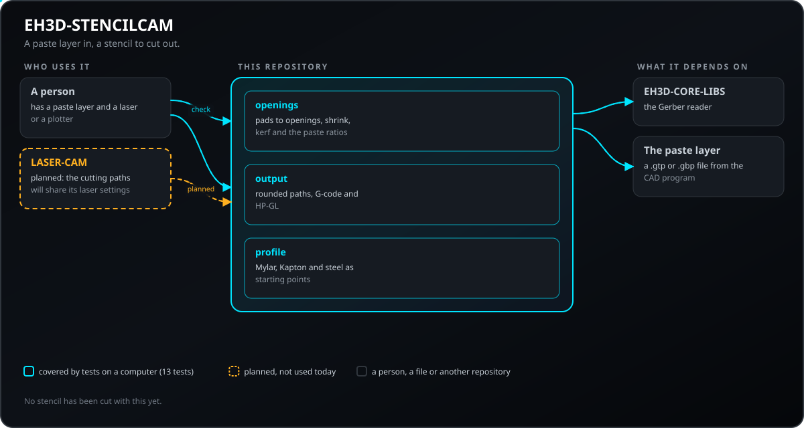
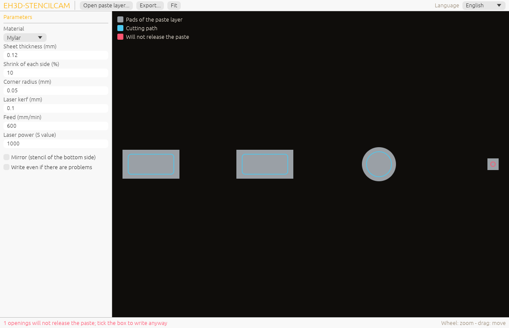
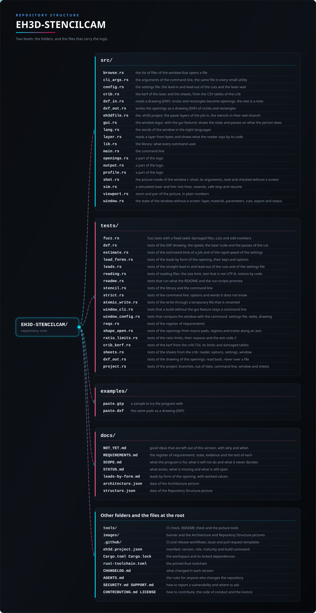

<p align="center">
  
</p>

#  EH3D-STENCILCAM
<p align="center"><a href="README.md">🇺🇸 English</a> | 🇪🇸 <b>Español</b> | <a href="README_fra.md">🇫🇷 Français</a> | <a href="README_ita.md">🇮🇹 Italiano</a> | <a href="README_deu.md">🇩🇪 Deutsch</a> | <a href="README_zho.md">🇨🇳 中文</a> | <a href="README_jpn.md">🇯🇵 日本語</a> | <a href="README_por.md">🇵🇹 Português</a></p>

### Plantillas de pasta de soldadura desde la capa de pasta: aperturas, comprobación de proporciones y trayectorias de corte

<p align="center">
  
  
  
  
  
</p>

---

**Comprobación de honestidad - lo que funciona hoy:** una biblioteca Rust y un programa de línea de comandos (`eh3d-stencilcam`) con 346 pruebas que se ejecutan en un ordenador: convierte los pads de una capa de pasta en aperturas de plantilla (reducidas, redondeadas, compensadas por el kerf del láser y comprobadas para la salida de la pasta) y las escribe como G-code o HP-GL. Tiene una ventana (se compila con `--features gui`) que abre una capa de pasta y dibuja los pads y las trayectorias de corte, pero esa ventana todavía no se ha visto en una pantalla; no se ha probado en una máquina y no se ha comprobado con una colección de ficheros reales.

---

> **Estado de seguridad:** este programa no controla ninguna máquina y no es un sistema de seguridad. Lo que produce debe revisarlo una persona antes de ejecutar nada en una máquina; nada de esto se ha ejecutado en hardware real.


## 📋 De un vistazo

| | |
|---|---|
| Versión | `0.1.5` |
| Madurez | Funcional |
| Pruebas | 346 |
| Pila tecnológica | Rust |
| En hardware real | No probado: nada de esto se ha ejecutado en una máquina |

**Ir a:** [Resumen](#-resumen) · [Arquitectura](#-arquitectura) · [Inicio rápido](#-inicio-rápido) · [Pruebas](#-pruebas) · [Estructura](#-estructura-del-repositorio) · [Relacionados](#-proyectos-relacionados)

## 🚦 Estado del proyecto

Cada línea es una parte de este repositorio y la luz dice hasta dónde llega hoy. Se escribe con lo que el repositorio puede demostrar (pruebas, compilaciones, ejecuciones), no con lo previsto.

🟢 Hecho y verificado · 🟡 Funciona, con límites conocidos · 🟠 Hecho a medias o sin verificar · 🔴 Sin hacer o sin funcionar

| Área | Estado | Qué significa aquí |
|---|---|---|
| Núcleo | 🟡 | convierte los pads de una capa de pasta en aperturas de plantilla (reducidas, redondeadas, compensadas por el kerf del láser y comprobadas para la salida de la pasta) y las escribe como G-code o HP-GL; probado en un ordenador con entradas normales y dañadas, no con una colección de ficheros reales. |
| Línea de comandos | 🟡 | `eh3d-stencilcam` ejecuta las mismas funciones que la biblioteca e imprime el resultado; cada error vuelve como mensaje y un código de salida distinto de cero. |
| Pruebas | 🟡 | 346 pruebas pasan (`cargo test`), con casos normales, casos límite y entradas dañadas, y un láser simulado con un enlace que pierde y daña líneas al azar (con semilla), reenvíos, parada segura y reanudación. |
| Seguridad | 🟡 | Rust seguro y simple (`forbid(unsafe_code)`): nada entra en pánico con los ficheros recibidos y un valor malo es un error con su motivo; sin revisión independiente. |
| Ventana | 🟠 | Escrita (egui, `--features gui`): abrir o soltar una capa de pasta, elegir el material, editar los parámetros, ver los pads y las trayectorias de corte (en rojo las aperturas que no soltarán la pasta), zoom y desplazamiento, exportar; su lógica está probada, pero todavía no se ha compilado ni visto en una pantalla. |
| Hardware real | 🔴 | No probado: nada de esto se ha ejecutado en una máquina. |
| Documentación | 🟡 | README en ocho idiomas, el registro de cambios y las dos imágenes dibujadas desde `docs/`. |

## 🎯 Resumen

* **Las aperturas** (`src/openings.rs`): cada pad destellado en la capa de pasta (rectangular, redondo u ovalado, en milímetros sean cuales sean las unidades del fichero) es una apertura; se reduce por el porcentaje del material y la línea de corte se hace más pequeña por el kerf del láser para que el agujero salga del tamaño pedido. Una plantilla para la cara inferior puede reflejarse.
* **Las proporciones** (`src/openings.rs`): la relación de aspecto (el lado pequeño entre el grosor de la lámina, al menos 1,5) y la relación de área (el área de la apertura entre el área de sus paredes, al menos 0,66) dicen si la pasta saldrá de la apertura; una apertura que falla se indica con su posición y `convert` se niega a escribir hasta que se mire (o `--force`).
* **Las trayectorias** (`src/output.rs`, `src/profile.rs`): rectángulos redondeados, círculos y óvalos como trayectorias cerradas en el orden de un recorrido al más cercano; G-code para un láser a potencia constante con el láser apagado al desplazarse, o HP-GL a 40 unidades por milímetro; perfiles de Mylar, Kapton y acero con su grosor, reducción, radio de esquina y kerf como puntos de partida.
* **No se escribe una plantilla incompleta:** `convert` se niega a escribir el fichero cuando la capa tiene pads, pistas o regiones que no pueden ser aberturas (un polígono, una región que no es un rectángulo, una pista en ángulo), salvo que se dé `--force`.
* **La capa se lee desde sus bytes:** `--max-bytes N` rechaza un fichero que pasa del límite (256 MiB por defecto); el texto que no es UTF-8 se lee como Latin-1 con un aviso. Los avisos y errores del lector se imprimen con su código estable y `--hide CODE[,CODE]` omite los avisos de esos códigos; un error del lector cuenta como una parte perdida de la capa, así que `convert` se niega salvo que se dé `--force`. Las aperturas salen de la conversión de aperturas de EH3D-GERBERVIEWER, y un pad poligonal se corta como un círculo (con una nota, así que `convert` también se niega salvo que se dé `--force`). `--arc-tolerance MM` fija la precisión de los arcos, y el rechazo de un fichero demasiado grande se escribe en el idioma del sistema. Una capa con dos unidades distintas, un segundo formato diferente o una palabra escrita dos veces en un bloque (`units-conflict`, `format-redefined`, `word-repeated`) se rechaza de la misma forma, y la ventana también muestra estas líneas.

## 🧩 Papel en EH3D

EH3D-STENCILCAM es un programa de la EH3D Fabrication Suite. Funciona como biblioteca y línea de comandos y, compilado con `--features gui`, como ventana con el aspecto que comparten los demás programas de la suite. Lee y escribe ficheros simples, así que puede usarse solo o entre los demás programas.

## 🏛️ Arquitectura

<p align="center">
  
</p>


Cómo encajan las partes de este repositorio: quién lo usa, qué contiene y de qué depende. La imagen se dibuja desde `docs/architecture.json` y se comprueba con el código.

## 🖼️ Capturas de pantalla

<p align="center">
  
</p>

<p align="center"><em>La ventana con la capa de pasta de ejemplo: los pads, la trayectoria de corte de cada apertura y la apertura que no soltará la pasta, con su aviso abajo.</em></p>

## ✨ Funciones

* **Biblioteca y línea de comandos:** cada orden de `eh3d-stencilcam` es una función de la biblioteca, así que otro programa de la suite puede llamarla sin lanzar un proceso.
* **Línea de comandos estricta:** una opción mal escrita (`--powr`) o una palabra de más es un error que la nombra, no algo que se ignora; si no, el programa haría su salida con los valores por defecto.
* **Pruebas con entradas dañadas:** las pruebas también dan ficheros vacíos, basura, números enormes y ficheros cortados, y ninguna puede provocar un pánico.
* **Sin adivinar:** un valor que no tiene sentido es un error que dice cuál y por qué, nunca un resultado que solo lo parece.
* **El programa para el láser nunca queda a medio escribir:** el fichero de G-code o HP-GL se escribe en un fichero temporal junto al real y se renombra encima, en la línea de comandos y en la ventana, de modo que un corte o un disco lleno dejan entero el fichero anterior y no un programa que se detiene a mitad de un corte. Si falla, se borra el temporal y el error empieza con el código `file_unwritable` y el nombre del fichero.
* **Sin código unsafe:** `#![forbid(unsafe_code)]` en la biblioteca y el programa.
* **El G-code lleva la cabecera estándar y un orden más rápido:** el fichero empieza con líneas de comentario del generador, las unidades y la capa con su SHA-256, un rectángulo de esquinas vivas no tiene puntos repetidos y el orden de los cortes se halla con una rejilla, de modo que cien mil aperturas se ordenan en un momento.
* **Una espera tras encender el láser:** `--laser-wait SEGUNDOS` escribe una espera `G4` después de cada `M3` para que el láser esté a su potencia antes de mover el cabezal (0 por defecto: sin espera); las pruebas vuelven a leer el G-code con el lector de la suite y no encuentran ningún aviso ni ningún corte con el láser apagado. `--rapid MM_MIN` (o `rapid_mm_min` en `stencil.cfg`, de 100 a 100000, 0 por defecto: sin estimación) es la velocidad de los movimientos con el láser apagado: `convert` imprime entonces el tiempo estimado del trabajo en G-code (corte, espera del láser y desplazamientos; no cuenta la aceleración de la máquina).
* **Colocar la plantilla en la lámina:** `--origin X,Y` lleva la esquina inferior izquierda de las aberturas a X,Y y `--bed ANCHO,ALTO` se niega a escribir cuando el cabezal saldría de la mesa, con un punto de un contorno o, en G-code, con el inicio de una entrada o el final de una salida; sin ellas se usan las coordenadas de la placa tal cual. La ventana escribe el programa que escribe `convert` con los mismos valores: tiene entre sus parámetros las entradas y salidas del corte (también por forma), la espera del láser, las pasadas, el origen y la mesa, y deja fuera una abertura repetida en el mismo sitio.
* **Un tramo recto de entrada y de salida en cada corte:** el G-code puede entrar en cada contorno por una recta tangente a su primer segmento y salir por la prolongación del último (0,3 mm cada uno por defecto, `--lead-in MM`, `--lead-out MM` o `lead_in_mm` y `lead_out_mm` en `stencil.cfg`; 0 no escribe ninguno y el programa es el que se escribe sin tramos). El láser sigue apagado mientras el cabezal viaja al inicio de la entrada, se enciende allí (y espera, si se pide) y se apaga al final de la salida. Los contornos son convexos y van en sentido antihorario, así que ambos tramos quedan fuera de la apertura, sobre la lámina que se conserva; en HP-GL no se escribe ningún tramo.
* **Entradas y salidas por forma:** una apertura redonda y una rectangular pueden tener su propia entrada y salida (`--lead-in-round MM`, `--lead-out-round MM`, `--lead-in-rect MM`, `--lead-out-rect MM` o `lead_in_round_mm`, `lead_out_round_mm`, `lead_in_rect_mm`, `lead_out_rect_mm` en `stencil.cfg`, de 0 a 5 mm); la que no se da es la general `--lead-in` o `--lead-out`, y una apertura oblonga usa siempre las generales. La estimación del tiempo cuenta las de cada forma. Véase `docs/leads-by-form.md`.
* **Un dibujo como entrada, y la velocidad, la escala del láser y las pasadas en `stencil.cfg`:** un fichero que acaba en `.dxf` se lee como dibujo (los círculos pasan a ser aberturas redondas y los rectángulos cerrados con los lados sobre los ejes, rectangulares; se lee la unidad del dibujo y cualquier otra entidad es un aviso, así que `convert` se niega a escribir salvo con `--force`); `--feed`, `--smax` y `--passes` (`feed_mm_min`, `smax` y `passes` en el fichero; por defecto 600 mm/min, 1000 y una pasada) fijan la velocidad del corte, el tope de la escala de potencia del láser y cuántas veces se corta cada contorno. Probado solo en el ordenador: nada se ha cortado en un láser.
* **Puentes estrechos, aberturas repetidas y la pasta en `check`:** `--min-web MM` (o `min_web_mm` en `stencil.cfg`, de 0 a 5 mm, 0,1 por defecto, 0 para no avisar) avisa, en `check` y en `convert`, de dos aberturas cuyo puente (la lámina que queda entre ellas) es más estrecho, o que se tocan o se solapan, y nunca detiene `convert`; dos aberturas de la misma forma, tamaño y lugar son un solo agujero, así que la segunda se deja fuera con un aviso en vez de cortarse dos veces; `check` imprime cuántas aberturas hay de cada forma y la pasta que contienen (en microlitros) y `check --json` imprime eso y el resto del resultado como un único objeto JSON para otros programas. Probado solo en un ordenador.
* **La lámina del almacén de herramientas:** `--sheet-file LAMINAS.csv --sheet NOMBRE` (o `sheet_file` y `sheet_name` en `stencil.cfg`) toma una lámina de la tabla de láminas que exporta el almacén de herramientas (`export-sheets-csv`): su espesor, su reducción de cada abertura por lado, su kerf (un kerf de 0 toma la anchura del haz del láser de `--crib`) y sus límites de relación sustituyen a los del material. Las columnas se buscan por su nombre, el fichero se lee con un límite de tamaño (1 MiB) y de filas, cada fallo nombra su fila, y la línea de comandos manda sobre la lámina y la lámina sobre el fichero de ajustes. Ninguna cifra es un valor por defecto de este programa: un límite de 0 no da ninguno. La ventana muestra la lámina elegida.
* **Un dibujo como salida:** `convert CAPA SALIDA.dxf` escribe las aberturas como las tiene la plantilla, círculos y rectángulos en milímetros, de modo que este mismo programa las vuelve a leer; una abertura oblonga se rechaza salvo que `--force` la deje fuera, y un fichero que existe nunca se sustituye salvo con `--overwrite` (`--create`, el valor por defecto, lo rechaza).
* **La ventana lee `stencil.cfg`, avisa de los puentes estrechos y dibuja:** lee el fichero de ajustes como `--config` (el botón *Fichero de ajustes...*, un `.cfg` soltado sobre ella o `gui --config FICHERO`), con los mismos rangos y rechazos, la lámina que nombra y el tiempo estimado; muestra los pares de aberturas cuyo puente es más estrecho que `min_web_mm`; y un nombre acabado en `.dxf` recibe el dibujo que escribe `convert`, nunca encima de un fichero que existe.

## 🔒 Seguridad y protección

| Amenaza | Defensa |
|---|---|
| Un fichero dañado, cortado o vacío | sin pánico: las pruebas cortan una entrada válida en cada posición y dan basura |
| Un número sin sentido (negativo, no finito, absurdamente grande) | se rechaza con un error que nombra el valor; nada se redondea hasta parecer plausible |
| Uso inseguro de memoria | Rust seguro y simple con `forbid(unsafe_code)` |

**Lo que no se defiende:** un resultado producido sin errores no es un resultado verificado. Nada de esto conoce los límites de una máquina y el programa no ha tenido revisión independiente. Informe de una vulnerabilidad en privado (véase [SECURITY.md](SECURITY.md)).

## 🔌 Interfaces

La biblioteca es `eh3d_stencilcam` (`use eh3d_stencilcam::...`); la línea de comandos es `eh3d-stencilcam`. Las órdenes son estas; cada una imprime su resultado por la salida estándar e informa de un error por la salida de errores con un código de salida distinto de cero. No hay acceso a la red.

```text
EH3D-STENCILCAM/
├── src/
│   ├── browse.rs                                la lista de ficheros de la ventana que abre un fichero
│   ├── cli_args.rs                              los argumentos de la línea de comandos, el mismo fichero en cada utilidad pequeña
│   ├── config.rs                                el fichero de ajustes: la entrada y la salida de los cortes y la espera del láser
│   ├── crib.rs                                  el kerf del láser y las láminas, desde las tablas CSV del pañol
│   ├── dxf_in.rs                                lee un dibujo (DXF): círculos y rectángulos pasan a ser aberturas, lo demás es un aviso
│   ├── dxf_out.rs                               escribe las aberturas como un dibujo (DXF) de círculos y rectángulos
│   ├── eh3dfile.rs                              el proyecto .eh3d: entran las capas de pasta del trabajo, las plantillas quedan en su rama
│   ├── gui.rs                                   la ventana (egui, con la característica gui): dibuja el estado y transmite lo que hace la persona
│   ├── lang.rs                                  las palabras de la ventana en los ocho idiomas
│   ├── layer.rs                                 lee una capa desde bytes y muestra lo que dice el lector por su código
│   ├── lib.rs                                   la biblioteca: lo que usa cada orden
│   ├── main.rs                                  la línea de comandos
│   ├── openings.rs                              una parte de la lógica
│   ├── output.rs                                una parte de la lógica
│   ├── profile.rs                               una parte de la lógica
│   ├── shot.rs                                  el modo de captura de la ventana (--shot): sus argumentos, leídos y comprobados sin pantalla
│   ├── sim.rs                                   un láser y un enlace simulados: líneas perdidas, reenvíos, parada segura y reanudación
│   ├── viewport.rs                              zoom y desplazamiento de la imagen, en números simples
│   └── window.rs                                el estado de la ventana sin pantalla: capa, material, parámetros, cortes, exportación y estado
├── tests/
│   ├── fuzz.rs                                  pruebas con semilla fija: ficheros dañados, cortes y números raros
│   ├── dxf.rs                                   pruebas del dibujo DXF, la velocidad, la escala del láser y las pasadas del corte
│   ├── estimate.rs                              pruebas del tiempo estimado de un trabajo y de la velocidad rápida de los ajustes
│   ├── lead_forms.rs                            pruebas de la entrada y salida por forma de la apertura y de sus ajustes
│   ├── leads.rs                                 pruebas de la entrada y la salida rectas de los cortes y del fichero de ajustes
│   ├── reading.rs                               pruebas de lectura de ficheros: el límite de tamaño, texto que no es UTF-8, avisos por código
│   ├── readme.rs                                pruebas que ejecutan lo que prometen el README y los scripts run
│   ├── stencil.rs                               pruebas de la biblioteca y la línea de comandos
│   ├── strict.rs                                pruebas de la línea de comandos: opciones y palabras que no conoce
│   ├── atomic_write.rs                          pruebas de la escritura por un fichero temporal que se renombra
│   ├── window_cli.rs                            pruebas de que una compilación sin la característica gui sigue siendo solo línea de comandos
│   ├── window_config.rs                         pruebas que comparan la ventana con el comando: ajustes, puentes, dibujo
│   ├── reqs.rs                                  pruebas del registro de requisitos
│   ├── shape_open.rs                            pruebas de las aperturas desde pads de macro, regiones y pistas sobre un eje
│   ├── ratio_limits.rs                          pruebas de los límites de relación, sus motivos y el código de salida 2
│   ├── crib_kerf.rs                             pruebas del kerf desde el CSV del pañol, sus límites y tablas dañadas
│   ├── sheets.rs                                pruebas de las láminas del pañol: lector, opciones, ajustes y ventana
│   ├── dxf_out.rs                               pruebas del dibujo de las aberturas: lectura de vuelta, nunca sobre un fichero
│   └── project.rs                               pruebas del proyecto: ramas, desactualizado, línea de comandos, ventana y láminas
├── examples/
│   ├── paste.gtp                                una muestra para probar el programa
│   └── paste.dxf                                las mismas almohadillas como dibujo (DXF)
├── docs/
│   ├── NOT_YET.md                               buenas ideas fuera de esta versión, con el porqué y el cuándo
│   ├── REQUIREMENTS.md                          el registro de requisitos: estado, evidencia y la prueba de cada uno
│   ├── SCOPE.md                                 para qué sirve, qué no hará y qué no decide nunca
│   ├── STATUS.md                                qué existe, qué falta y qué sigue abierto
│   ├── leads-by-form.md                         entrada y salida por forma de apertura, con valores calculados
│   ├── architecture.json                        datos de la imagen de Arquitectura
│   └── structure.json                           datos de la imagen de Estructura
├── tools/                                       comprobación del CI y del README y herramientas de imágenes
├── images/                                      banner y las imágenes de Arquitectura y Estructura del repositorio
├── .github/                                     flujos de CI y de publicación, plantillas de issues y pull requests
├── eh3d.project.json                            manifiesto: versión, rol, madurez y comando de compilación
├── Cargo.toml Cargo.lock                        el workspace y sus dependencias fijadas
├── rust-toolchain.toml                          la toolchain de Rust fijada
├── CHANGELOG.md                                 qué cambió en cada versión
├── AGENTS.md                                    las reglas para quien cambie el repositorio
├── SECURITY.md SUPPORT.md                       cómo informar de una vulnerabilidad y dónde preguntar
└── CONTRIBUTING.md CODE_OF_CONDUCT.md LICENSE   cómo contribuir, el código de conducta y la licencia
```

**El proyecto de la suite.** Un fichero `.eh3d` tiene una rama por programa. `project info FICHERO.eh3d` muestra las capas del trabajo (la rama `manufacturing/`, un paquete `.eh3dproj`) y las plantillas guardadas en el proyecto; `project convert FICHERO.eh3d [--layer NOMBRE] [--plt]` convierte cada capa de pasta del trabajo (o la nombrada) en una plantilla, con las mismas opciones y los mismos rechazos que `convert`, y la guarda solo en la rama `stencilcam/`, con una copia de la capa y el contenido de la rama de la que viene. Si el trabajo cambia después, `project info` avisa de que las plantillas están desactualizadas y termina con 2. En la ventana, un `.eh3d` soltado abre las capas de pasta de su trabajo (la cara de arriba y la de abajo se eligen de una lista) y la plantilla se guarda en el proyecto, y una tabla de láminas (`.csv`, soltada o abierta con su botón) ofrece sus láminas en una lista. Cuando guardar quitaría una firma del proyecto o de su rama, la ventana pregunta antes y no escribe nada si no se acepta. La ventana no escribe sobre un proyecto que otro programa ha guardado desde que se abrió o se guardó en ella, tampoco si se guardó mientras una pregunta esperaba: lo dice y ofrece volver a leer el proyecto (con la misma capa si el trabajo aún la tiene), guardar una copia con otro nombre con la plantilla dentro, o cerrar. La orden `project convert` también lo comprueba: si otro programa guarda el proyecto mientras se hacen las plantillas, no se escribe nada encima.

## ⚙️ Configuración

Un pequeño fichero de ajustes, `stencil.cfg` (`clave = valor`, uno por línea, `#` empieza un comentario), guarda lo que merece afinarse: `lead_in_mm` y `lead_out_mm`, la longitud del tramo recto de entrada antes de cada contorno y del de salida después (0,3 mm por defecto, de 0 a 5; 0 no escribe ninguno), y `laser_wait_s`, la espera tras encender el láser (0 por defecto, hasta 60). `eh3d-stencilcam config` imprime el fichero con cada valor por defecto (`examples/stencil.cfg` es ese fichero) y `--config FICHERO` lee uno; `--lead-in MM`, `--lead-out MM` y `--laser-wait SEGUNDOS` dan los mismos ajustes en la línea de comandos y ganan al fichero. Una clave desconocida, repetida o fuera de su rango es un error que dice su línea. Lo demás se da como argumentos de la línea de comandos (véase Interfaces) y cada valor por defecto está escrito en la ayuda de la orden (`eh3d-stencilcam help`). Los límites fijos están en el código como constantes con nombre y las pruebas los cubren. `lead_in_round_mm`, `lead_out_round_mm`, `lead_in_rect_mm`, `lead_out_rect_mm` (con las opciones `--lead-in-round`, `--lead-out-round`, `--lead-in-rect` e `--lead-out-rect`) dan la entrada y la salida de las aperturas redondas y de las rectangulares; en el fichero van como comentarios y, si no se dan, se usan las generales `lead_in_mm` y `lead_out_mm`. `min_web_mm` (con `--min-web`) es el puente más estrecho entre dos aberturas del que no se avisa (0,1 mm por defecto, de 0 a 5; 0 no da aviso). `min_aspect` y `min_area` (con `--min-aspect` y `--min-area`) son los límites de relación por debajo de los cuales una apertura no suelta la pasta (1,5 y 0,66 por defecto), y `region_fit_percent` (con `--region-fit`, 0 por defecto, hasta 20) abre como rectángulo una región que llena casi todo su rectángulo, como un pad con las esquinas cortadas. `--crib FICHERO.csv --crib-laser NOMBRE` toma el kerf de una herramienta láser del CSV que exporta el pañol de herramientas. Una comprobación que no se supera termina con el código 2.

**Modo servidor.** `convert --to-server` guarda en el servidor EH3D, como artefacto, el G-code (o el trazado HP-GL) que acaba de escribir, con los valores con que se cortó, y `check --json --to-server` guarda el resultado de la comprobación, para que los demás programas de la suite los encuentren allí. El enlace es el cliente único de la suite (`eh3d-serverclient` de EH3D-COMMON) y sus claves van en el archivo de ajustes: `server_address` (`host:port`; vacío significa apagado), `server_token` (solo escritura, nunca se muestra), `server_machine`, `server_timeout_s` (1 a 120, 15 por defecto), `server_retries` (0 a 5, 2 por defecto), `server_mdns` (`off` por defecto) y `server_max_answer_mib` (1 a 256, 8 por defecto). Las negativas del servidor se explican por su código en el idioma del sistema. `eh3d-stencilcam server status --config FILE` muestra los ajustes (el token como `***`) y lo que responde el servidor. No se envía nada sin dirección y el trabajo local nunca depende del servidor.

## 🚀 Inicio rápido

Necesita una cadena de herramientas Rust estable (1.89 o más reciente).

```bash
cargo build --release
cargo test
cargo run --release -- check examples/paste.gtp
cargo run --release --features gui   # the window
cargo run --release --features gui -- --shot screen.png examples/paste.gtp   # a picture of the window
```

Para sacar una captura de la ventana sin abrirla a mano, ejecútelo con `--shot FICHERO.png` (también `--size WxH`, `--theme forge|dark|light`, `--wait N`, `--lang CODE`, `--open FILE`, `--replace`): se abre con ese tamaño, guarda el PNG, no guarda ajustes y se cierra solo (código de salida 0 si se escribió el fichero, 1 si no, 2 si los argumentos están mal).

## 🧪 Pruebas

El conjunto tiene 346 pruebas (`cargo test`, ejecutadas en Windows y Linux en el CI). Comprueban los casos normales, los casos límite y las entradas dañadas: ficheros vacíos, basura y ficheros cortados nunca provocan un pánico. El CI ejecuta además `cargo fmt --check`, `cargo clippy` con las advertencias como errores y `python -I tools/ci_validate.py`.

## 🏗️ Compilación y publicación

La versión está en `Cargo.toml` y en `eh3d.project.json`; cada versión tiene su entrada en [CHANGELOG.md](CHANGELOG.md). `build.bat` / `build.sh` compilan el programa, `test.bat` / `test.sh` ejecutan las pruebas y `run.bat` / `run.sh` lo ejecutan con un ejemplo. Las versiones se publican en GitHub.

### Descargas

Cada versión trae el programa con su ventana para Windows (64 y 32 bits), Linux (64 bits) y macOS (Apple silicon e Intel), como `<nombre>-<versión>-<sistema>.zip` (Windows) o `.tar.gz` con el programa, la licencia, el léame, el icono y los ejemplos. Los ficheros los construye GitHub Actions, van en `SHA256SUMS` y están firmados con la clave de EH3D. Para comprobar una descarga, compara su hash con el fichero `.sha256` que la acompaña (`sha256sum -c`) y comprueba su firma con el fichero `.sig` que la acompaña (`ssh-keygen -Y verify`).

## 📂 Estructura del repositorio

<p align="center">
  
</p>

<details>
<summary>Versión en texto del árbol</summary>

```text
EH3D-STENCILCAM/
├── src/
│   ├── browse.rs                                la lista de ficheros de la ventana que abre un fichero
│   ├── cli_args.rs                              los argumentos de la línea de comandos, el mismo fichero en cada utilidad pequeña
│   ├── config.rs                                el fichero de ajustes: la entrada y la salida de los cortes y la espera del láser
│   ├── dxf_in.rs                                lee un dibujo (DXF): círculos y rectángulos pasan a ser aberturas, lo demás es un aviso
│   ├── gui.rs                                   la ventana (egui, con la característica gui): dibuja el estado y transmite lo que hace la persona
│   ├── lang.rs                                  las palabras de la ventana en los ocho idiomas
│   ├── layer.rs                                 lee una capa desde bytes y muestra lo que dice el lector por su código
│   ├── lib.rs                                   la biblioteca: lo que usa cada orden
│   ├── main.rs                                  la línea de comandos
│   ├── openings.rs                              una parte de la lógica
│   ├── output.rs                                una parte de la lógica
│   ├── profile.rs                               una parte de la lógica
│   ├── shot.rs                                  el modo de captura de la ventana (--shot): sus argumentos, leídos y comprobados sin pantalla
│   ├── sim.rs                                   un láser y un enlace simulados: líneas perdidas, reenvíos, parada segura y reanudación
│   ├── viewport.rs                              zoom y desplazamiento de la imagen, en números simples
│   └── window.rs                                el estado de la ventana sin pantalla: capa, material, parámetros, cortes, exportación y estado
├── tests/
│   ├── fuzz.rs                                  pruebas con semilla fija: ficheros dañados, cortes y números raros
│   ├── dxf.rs                                   pruebas del dibujo DXF, la velocidad, la escala del láser y las pasadas del corte
│   ├── estimate.rs                              pruebas del tiempo estimado de un trabajo y de la velocidad rápida de los ajustes
│   ├── lead_forms.rs                            pruebas de la entrada y salida por forma de la apertura y de sus ajustes
│   ├── leads.rs                                 pruebas de la entrada y la salida rectas de los cortes y del fichero de ajustes
│   ├── reading.rs                               pruebas de lectura de ficheros: el límite de tamaño, texto que no es UTF-8, avisos por código
│   ├── readme.rs                                pruebas que ejecutan lo que prometen el README y los scripts run
│   ├── stencil.rs                               pruebas de la biblioteca y la línea de comandos
│   ├── strict.rs                                pruebas de la línea de comandos: opciones y palabras que no conoce
│   ├── atomic_write.rs                          pruebas de la escritura por un fichero temporal que se renombra
│   ├── window_cli.rs                            pruebas de que una compilación sin la característica gui sigue siendo solo línea de comandos
│   └── reqs.rs                                  pruebas del registro de requisitos
├── examples/
│   ├── paste.gtp                                una muestra para probar el programa
│   └── paste.dxf                                las mismas almohadillas como dibujo (DXF)
├── docs/
│   ├── NOT_YET.md                               buenas ideas fuera de esta versión, con el porqué y el cuándo
│   ├── REQUIREMENTS.md                          el registro de requisitos: estado, evidencia y la prueba de cada uno
│   ├── SCOPE.md                                 para qué sirve, qué no hará y qué no decide nunca
│   ├── STATUS.md                                qué existe, qué falta y qué sigue abierto
│   ├── leads-by-form.md                         entrada y salida por forma de apertura, con valores calculados
│   ├── architecture.json                        datos de la imagen de Arquitectura
│   └── structure.json                           datos de la imagen de Estructura
├── tools/                                       comprobación del CI y del README y herramientas de imágenes
├── images/                                      banner y las imágenes de Arquitectura y Estructura del repositorio
├── .github/                                     flujos de CI y de publicación, plantillas de issues y pull requests
├── eh3d.project.json                            manifiesto: versión, rol, madurez y comando de compilación
├── Cargo.toml Cargo.lock                        el workspace y sus dependencias fijadas
├── rust-toolchain.toml                          la toolchain de Rust fijada
├── CHANGELOG.md                                 qué cambió en cada versión
├── AGENTS.md                                    las reglas para quien cambie el repositorio
├── SECURITY.md SUPPORT.md                       cómo informar de una vulnerabilidad y dónde preguntar
└── CONTRIBUTING.md CODE_OF_CONDUCT.md LICENSE   cómo contribuir, el código de conducta y la licencia
```

</details>

## 🗺️ Hoja de ruta y límites conocidos

**Límites conocidos hoy**

* La ventana todavía no se ha visto en una pantalla y no muestra las relaciones de cada apertura: eso lo hace `check`.
* No se ha probado en una máquina ni con una colección de ficheros reales y no ha tenido revisión independiente.
* Un pad poligonal de la capa de pasta se corta como un círculo, y una pista en ángulo o una región que no es un rectángulo no se convierte en apertura (una nota dice por qué), los perfiles de los materiales son puntos de partida y no hay corte en varias pasadas para una lámina de acero.

**Siguiente**

* Probarlo con una capa de pasta real y un láser.
* Ver la ventana en una pantalla y completarla: una vista de las relaciones de pasta de cada apertura.
* Probarlo con ficheros reales y con los demás programas de la suite.

## 🌍 Idiomas

El README y los textos existen en inglés, español, francés, italiano, alemán, chino, japonés y portugués de Portugal.

## 🔗 Proyectos relacionados

* [EH3D-CORE-LIBS](https://github.com/JuanenRac/EH3D-CORE-LIBS): los lectores de Gerber, Excellon y G-code
* [EH3D-PHOENIX-LASER](https://github.com/JuanenRac/EH3D-PHOENIX-LASER): el grabado y corte por láser
* [EH3D-GERBERVIEWER](https://github.com/JuanenRac/EH3D-GERBERVIEWER): el visor de capas Gerber
* [EH3D-TOOL-MANAGER](https://github.com/JuanenRac/EH3D-TOOL-MANAGER): el almacén de herramientas que comparten los programas CAM
* [EH3D-CAM-DEBUGGER](https://github.com/JuanenRac/EH3D-CAM-DEBUGGER): la revisión del G-code antes de llegar a una máquina

## 📚 Documentación

* [Registro de cambios](CHANGELOG.md)
* [Alcance](docs/SCOPE.md): para qué sirve el programa, qué no hará y qué no decide nunca.
* [Requisitos](docs/REQUIREMENTS.md): el registro de capacidades, el estado de cada una y la prueba que la muestra.
* [Estado](docs/STATUS.md): qué existe, qué falta y qué sigue abierto.
* [Todavía no](docs/NOT_YET.md): buenas ideas que quedan fuera de esta versión.
* [Reglas para cambiar el repositorio](AGENTS.md): las reglas para quien cambie el repositorio.
* [Datos de arquitectura y estructura](docs/architecture.json): los datos con los que se dibujan las dos imágenes.

## 🤝 Contribuir y comunidad

* Antes de una pull request ejecute `cargo fmt --check`, `cargo clippy --all-targets -- -D warnings`, `cargo test` y `python -I tools/ci_validate.py`: todo debe pasar. Véanse [CONTRIBUTING.md](CONTRIBUTING.md) y el [código de conducta](CODE_OF_CONDUCT.md).
* El README existe en ocho idiomas: un cambio de texto se hace en los ocho ficheros, y las dos imágenes se dibujan desde `docs/architecture.json` y `docs/structure.json` con `tools/make_architecture.py` y `tools/make_structure.py`.
* Informe de una vulnerabilidad en privado: [SECURITY.md](SECURITY.md). Preguntas, ideas e informes: electrohobby3d@gmail.com ([SUPPORT.md](SUPPORT.md)).

## 👤 AUTOR

**JuanenRac (Electro Hobby 3D)** · electrohobby3d@gmail.com

## 📜 LICENCIA

Software: GPL-3.0-or-later. Véase [LICENSE](LICENSE). Los diseños de hardware de la suite usan CERN OHL-S.
